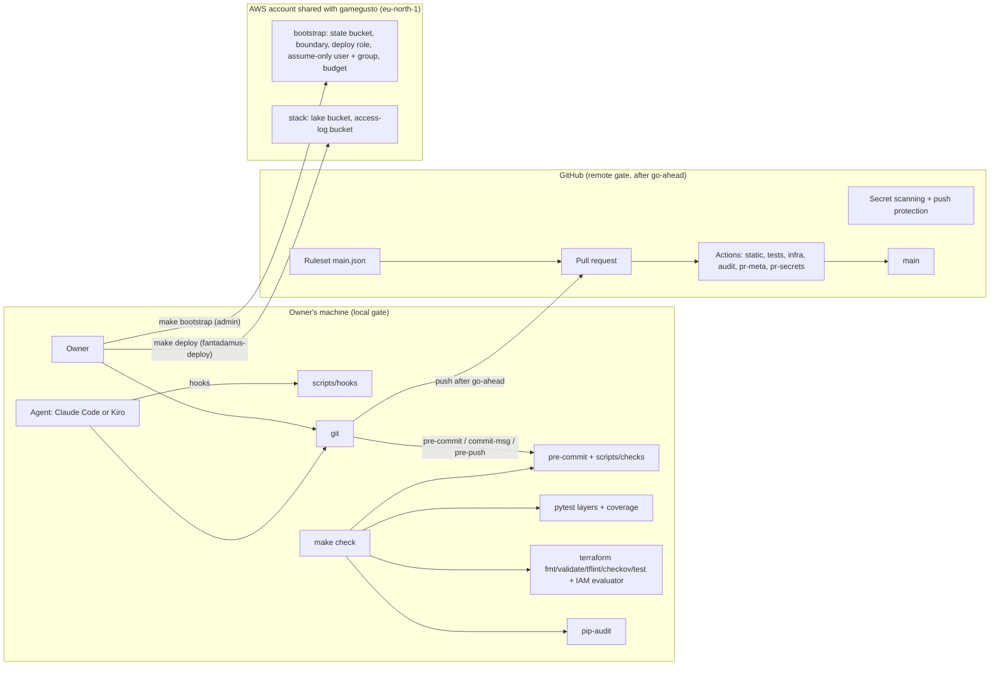
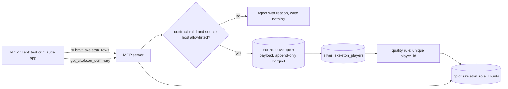
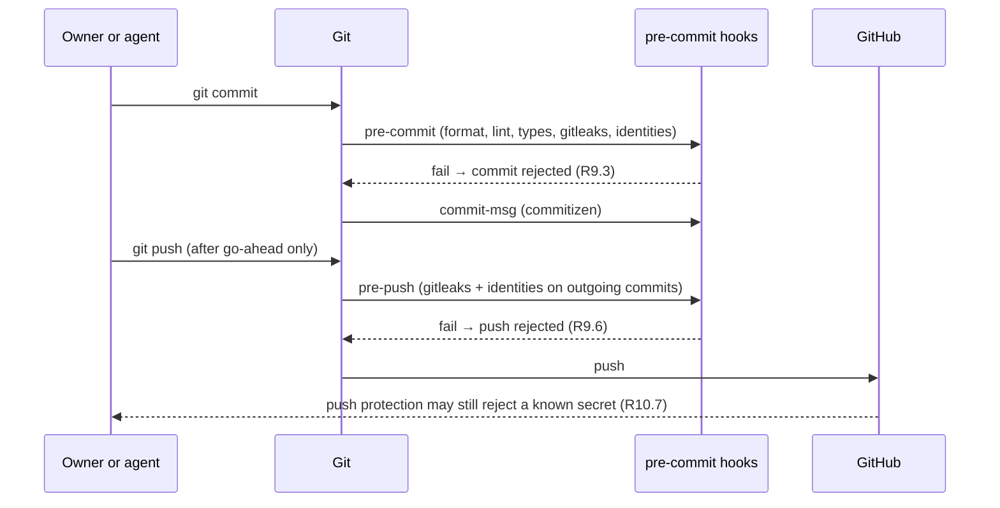
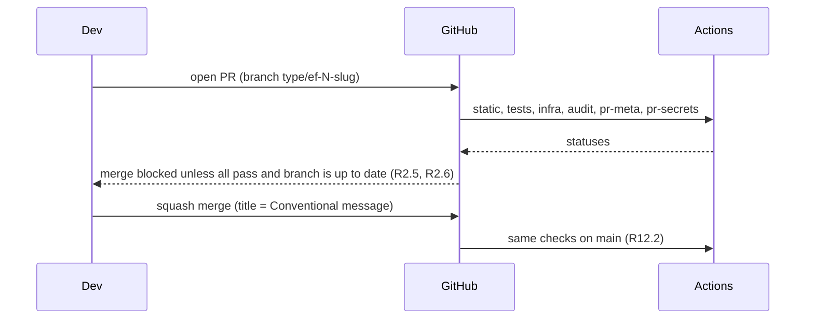

# Design Document: `engineering-foundation` (Spec 0)

Status: **Draft for owner review** · Date: 2026-10-24 · Implements the approved
[requirements](requirements.md) (152 criteria, AT-1 to AT-21).

## Overview

Spec 0 builds the repository's machinery and one thin pipeline that proves it works:

1. **One check command.** `make check` runs every gate, locally and in CI. CI runs it as four parallel
   jobs whose union is exactly `make check`, plus two jobs that only make sense on a pull request.
2. **Git gates.** pre-commit, commit-msg and pre-push hooks; the pre-push hook is the preventive gate,
   because the repository is public.
3. **GitHub as code.** The `main` ruleset, push protection and fork settings live as JSON and `gh api`
   calls, applied by `make` and checked for drift.
4. **Agent hooks.** One Python implementation, wired into Claude Code and Kiro.
5. **AWS skeleton.** A Terraform bootstrap (state, IAM, budget), applied once by the owner, and a stack
   (lake and log buckets), applied as a prefix-scoped deploy role.
6. **Walking skeleton.** The MVP's shape in miniature (ADR-0005): an MCP submit tool → contract validation
   and allowlist → bronze → silver → gold on DuckDB → an MCP read tool.

Nothing here talks to a data source. The only AWS resources cost a few cents a month (see the cost
estimate).

## Decisions this design depends on

The research gate requires an Accepted ADR before code depends on it. Per Q4, these ADRs are early tasks.
This design assumes their **proposed** outcome; if an ADR lands differently, this document is revised first.

| ADR | Proposed outcome | Needed before |
|---|---|---|
| ADR-0001 Tool choices | The toolchain in "Components" C3; commitizen for commit messages; Dependabot (uv, GitHub Actions, pre-commit ecosystems) or Renovate if Dependabot lacks pre-commit support; the hook blocking contract per agent (Claude Code: exit code 2; Kiro: verified by experiment) | Task 2 (Python project) |
| ADR-0002 IaC | **Terraform ≥ 1.11** with the AWS provider; `tflint`, `checkov`, `terraform test`; IAM policies as JSON templates shared with the Python evaluator (C8) | Bootstrap and infrastructure tasks |
| ADR-0003 Account, region, deploy identity | The gamegusto account; `eu-north-1`; bootstrap by admin; `fantadamus-terraform` (assume-only, in a group) → `fantadamus-deploy` (≤ 1 h sessions) | Bootstrap task |

## Research and references

How each reference shapes this design:

| Reference | What we take from it |
|---|---|
| AWS Prescriptive Guidance, [Deploy and manage a serverless data lake by using IaC](https://docs.aws.amazon.com/prescriptive-guidance/latest/patterns/deploy-and-manage-a-serverless-data-lake-on-the-aws-cloud-by-using-infrastructure-as-code.html) (SDLF) | All lake infrastructure under version control and changed only through a pipeline; separate raw, stage and analytics areas. At MVP scale we keep the areas as **prefixes in one lake bucket** (`bronze/`, `silver/`, `gold/`), and split them into buckets in v1 if access patterns need it. We use GitHub Actions instead of CodePipeline (public repo, free minutes), and keep deploys manual until v1 (R19.2). |
| [Guidance for Data Lakes on AWS](https://docs.aws.amazon.com/solutions/data-lakes-on-aws/) | The whole lake as IaC plus CI/CD; Glue Data Catalog, Lake Formation and Athena as the governed query layer. Those are **v1**; Spec 0 only lays the IaC and CI foundations they will sit on. |
| AWS Big Data Blog, [Navigating architectural choices for a lakehouse using Amazon SageMaker](https://aws.amazon.com/blogs/big-data/navigating-architectural-choices-for-a-lakehouse-using-amazon-sagemaker/) and [medallion architecture with Iceberg materialized views](https://aws.amazon.com/blogs/big-data/building-medallion-architecture-with-iceberg-materialized-views-in-amazon-sagemaker/) | The bronze/silver/gold naming and layer responsibilities the skeleton copies. S3 Tables vs self-managed Iceberg and materialized views are v1 decisions (`tech.md`). |
| HashiCorp, [Terraform tests: mocking](https://developer.hashicorp.com/terraform/language/tests/mocking) | Mocks need Terraform ≥ 1.7; mocked data sources return **generated** values unless overridden. So resource assertions run against `mock_provider`, but the IAM policies can't be rendered by a mocked `aws_iam_policy_document`. Hence the policies are JSON templates (C8). |
| AWS, [Testing CDK applications](https://docs.aws.amazon.com/cdk/v2/guide/testing.html) and [cdk-nag rule packs](https://docs.aws.amazon.com/prescriptive-guidance/latest/patterns/check-aws-cdk-applications-or-cloudformation-templates-for-best-practices-by-using-cdk-nag-rule-packs.html) | The rejected alternative in ADR-0002. Its ideas carry over: fine-grained assertions plus a snapshot, and a policy pack (checkov here) run at every change. |
| AWS, [Amazon S3 security best practices](https://docs.aws.amazon.com/AmazonS3/latest/userguide/security-best-practices.html) | Block Public Access on, default encryption, a `Deny` on `aws:SecureTransport = false`, server access logging, versioning where data matters (R14.3, R14.4). |
| AWS IAM, [permissions boundaries](https://docs.aws.amazon.com/IAM/latest/UserGuide/access_policies_boundaries.html) and [quotas](https://docs.aws.amazon.com/IAM/latest/UserGuide/reference_iam-quotas.html) | Roles created by the deploy role must carry the boundary; the managed-policy size limit of 6,144 characters (R22.5, R22.11). |
| AWS, [Budgets pricing](https://aws.amazon.com/aws-cost-management/aws-budgets/pricing/) | Budgets without actions are free to create and monitor; our one budget has no actions (R15). |
| Well-Architected DevOps Guidance: [continuous integration](https://docs.aws.amazon.com/wellarchitected/latest/devops-guidance/continuous-integration.html), [development lifecycle](https://docs.aws.amazon.com/wellarchitected/latest/devops-guidance/development-lifecycle.html), [QA.DT.1 data quality tests](https://docs.aws.amazon.com/wellarchitected/latest/devops-guidance/qa.dt.1-ensure-data-integrity-and-accuracy-with-data-quality-tests.html) | The same build locally and in CI; fast feedback; data-quality rules tested like code. The skeleton carries one quality rule end to end. |
| GitHub, [About rulesets](https://docs.github.com/en/repositories/configuring-branches-and-merges-in-your-repository/managing-rulesets/about-rulesets) and the rulesets REST API | A branch ruleset with `deletion`, `non_fast_forward`, `pull_request` (squash only) and strict `required_status_checks`, and **no bypass actors**, so admins are bound too (R2.2–R2.7). |
| MCP Python SDK, [Testing MCP servers](https://py.sdk.modelcontextprotocol.io/testing/) | An in-memory client session (`create_connected_server_and_client_session`) drives a `FastMCP` server in tests, with no network (R16.13). |
| Kiro [hooks](https://kiro.dev/docs/hooks/) and Claude Code [hooks](https://docs.claude.com/en/docs/claude-code/hooks) | Both pass the event as JSON on stdin to a command; Claude Code blocks with exit code 2. Kiro's trigger names and blocking contract are verified in ADR-0001 (R17.8). |
| The owner's gamegusto project (`~/Documents/gamegusto`) | The bootstrap/stack split, the deny-first deploy policy, the assume-only user, the IAM evaluator, the git conventions (requirements, "Reuse from gamegusto"). |

## Architecture



The walking skeleton (C10):



## Components and interfaces

### C1. Repository layout (files Spec 0 creates)

```
.claude/settings.json          Claude Code hooks → scripts/hooks
.kiro/hooks/*.json             Kiro hooks → scripts/hooks
.github/
  workflows/ci.yml             PR gate and main
  workflows/audit.yml          weekly dependency audit
  dependabot.yml               uv, github-actions, pre-commit (or renovate.json, per ADR-0001)
  rulesets/main.json           branch ruleset as code
  pull_request_template.md     DoD checklist + task, requirements, tests, ADRs
config/
  thresholds.toml              gate thresholds and their safe direction (R6.5, R8.4)
  sources.toml                 the submit tools' allowlist (MVP reading list hosts)
  audit-allowlist.toml         dependency-audit exceptions (id, reason, expiry)
docs/
  adr/0000-template.md, 0001-…, 0002-…, 0003-…
  quality/suppressions.md      the single suppression register
  runbooks/leak.md             R10.8
  reports/                     gate self-test report, task reports
infra/
  bootstrap/                   *.tf, policies/*.json.tftpl, tests/*.tftest.hcl
  stack/                       *.tf, tests/*.tftest.hcl, plan.snapshot.json
scripts/
  checks/                      one module per check (C4)
  hooks/                       agent hook logic (C7)
  tools/install.py             installs pinned non-Python tools into bin/ (R1.8)
  selftest/                    gate self-tests (C11)
  smoke/spec0.py               post-deploy smoke test (C9)
src/fantadamus/
  core/      hashing.py, clock.py, urls.py
  contracts/ base.py, envelope.py, skeleton/ (player.py, CHANGELOG.md), schemas/*.json
  lake/      duckdb_store.py
  domains/skeleton/ bronze.py, silver.py, gold.py
  quality/   rules.py
  mcp/       server.py (skeleton tools only in Spec 0)
  cli/       __main__.py  (`fantadamus skeleton run`)
tests/
  conftest.py, unit/, property/, contract/, integration/, acceptance/, infra/
  fixtures/skeleton/rows.json, golden/skeleton/role_counts.json
tool-versions.toml, Makefile, pyproject.toml, uv.lock, .pre-commit-config.yaml,
.gitleaks.toml, .editorconfig, .gitignore, README.md, private.example.toml, CLAUDE.md
```

- The README states that no licence is granted (R2.1).
- `tests/fixtures/README.md` and `tests/golden/README.md` state that their contents are synthetic and why
  they may be public (R2.9).
- `data/private/` and `data/local/` are git-ignored. No league member's name, team name or roster is ever
  a fixture (R2.10).

### C2. Make targets

| Target | Does | Requirements |
|---|---|---|
| `setup` | `uv sync --locked`; `scripts/tools/install.py` (pinned tools → `bin/`); `pre-commit install --hook-type pre-commit --hook-type commit-msg --hook-type pre-push` | R1.5, R1.8 |
| `check` | Runs `check-static`, `check-tests`, `check-infra` and `check-audit`, continuing past failures, then prints one pass/fail line per check and exits non-zero if any failed | R1.1–R1.3 |
| `check-static` | Lockfile, tool versions, format, lint (ruff, sqlfluff, yamllint, markdownlint, actionlint), types, suppressions, thresholds, ADR lint, hook-config validation, contract versions, identity scan and gitleaks over the tree | R3.4, R1.9, R4, R5, R6, R13, R17.7, R18.2, R10 |
| `check-tests` | pytest over all layers with `HYPOTHESIS_PROFILE=ci`, then the coverage gate | R7, R8, R16 |
| `check-infra` | For `bootstrap` and `stack`: `terraform fmt -check`, `init -backend=false`, `validate`, `tflint`, `checkov`, `terraform test`, plan-snapshot comparison; then the IAM evaluator suite | R14, R15.5, R22.9, R22.11 |
| `check-audit` | `pip-audit` on `uv.lock` with `config/audit-allowlist.toml` | R11.1–R11.3 |
| `test-fast` | Format, lint, unit and property tests with `HYPOTHESIS_PROFILE=dev` | R1.4 |
| `mutation` | `mutmut` on the modules in `[tool.fantadamus] core_modules` | R1.7 |
| `skeleton` | Runs the walking skeleton end to end on the fixture | R16.1 |
| `github-apply` / `github-verify` | Applies, or compares with, the ruleset, push protection, secret scanning and fork-approval settings through `gh api` | R2.12, R10.7, R12.8 |
| `bootstrap` | Shows `aws sts get-caller-identity` and the plan for `infra/bootstrap` under the admin profile; applies after interactive confirmation | R19.6 |
| `deploy` | Plans `infra/stack` as `fantadamus-deploy`, shows the diff, applies after confirmation, then runs the smoke test | R19.1, R19.4 |
| `selftest` | Runs the gate self-tests (`LOCAL=1` for local only) and writes the report | R20 |

### C3. Toolchain

- **Python (uv, `pyproject.toml`):** runtime: `pydantic`, `duckdb`, `mcp`. Dev: `ruff`, `mypy`, `pytest`,
  `pytest-cov`, `pytest-socket`, `pytest-asyncio`, `hypothesis`, `moto`, `boto3`, `checkov`, `sqlfluff`,
  `yamllint`, `pip-audit`, `mutmut`, `pre-commit`, `commitizen`. Python 3.12 in `requires-python` and
  `.python-version` (R3).
- **Pinned binaries (`tool-versions.toml`, installed into `bin/`):** `terraform`, `tflint`, `gitleaks`,
  `actionlint`, each with a version and per-platform SHA-256 (`darwin_amd64`, `darwin_arm64`,
  `linux_amd64`). `install.py` refuses a download whose checksum doesn't match. Node.js and
  `markdownlint-cli2` come through pre-commit's own pinned Node environment.
- **pre-commit stages** (every hook's `rev` pinned to a release tag or commit SHA, R9.4):

  | Stage | Hooks |
  |---|---|
  | pre-commit | ruff-format, ruff, mypy, sqlfluff, yamllint, markdownlint, actionlint, check-added-large-files, check-merge-conflict, `gitleaks` (staged), identity check (staged) |
  | commit-msg | commitizen (Conventional Commits) |
  | pre-push | `gitleaks` and the identity check over every outgoing commit, using `PRE_COMMIT_FROM_REF..PRE_COMMIT_TO_REF` |

### C4. Checks (`scripts/checks/`)

Each module is runnable as `python -m scripts.checks.<name>`, exits non-zero on failure, and prints one
summary line for `make check`.

| Module | Logic | Requirements |
|---|---|---|
| `lockfile` | `uv lock --check` | R3.4 |
| `tool_versions` | Compares each `bin/<tool> --version` with `tool-versions.toml`; prints expected and found | R1.9 |
| `suppressions` | Finds code suppressions (`# noqa`, `# type: ignore`, `pytest.mark.skip`/`xfail`, `#checkov:skip=`, `# tflint-ignore`) and file allowlist entries; requires a specific rule code and a reason (inline or the line above; a `reason` field in allowlist files); matches each to a row of `docs/quality/suppressions.md` by path and rule; fails on blank approval dates and on unused suppressions (ruff `RUF100`, mypy `warn_unused_ignores`, checkov's own unused-skip check) | R6.1–R6.4, R6.6, R6.7 |
| `thresholds` | Loads `config/thresholds.toml` from the working tree and from the base ref (`origin/main` in CI, `main` locally); fails if any value moved against its declared direction | R6.5, R8.4 |
| `coverage_gate` | Reads `coverage.json`; computes line and branch percentages separately over `src/` and `scripts/`; compares with `config/thresholds.toml` | R8 |
| `identities` | Loads identities from `FANTADAMUS_PRIVATE_CONFIG` or the `FANTADAMUS_CREATOR_IDENTITIES` secret (newline-separated); fails closed with instructions if absent; normalises both sides (NFKD, strip combining marks, casefold, collapse whitespace); scans staged files, a commit range or the tree; prints `path:line` only | R10.3–R10.6 |
| `contracts` | Imports every `Contract` subclass; regenerates its JSON Schema; compares with `src/fantadamus/contracts/schemas/*.json`; on difference requires a version bump in the class and a matching changelog heading; classifies breaking changes (removed or renamed property, newly required, narrowed type or enum) and requires a major bump for them | R13 |
| `adr_lint` | Each `docs/adr/NNNN-*.md` has a `Status:` line with a date and the sections Context, Options, Decision, Consequences and Sources (extra sections allowed), with at least one link under Sources | R18.1, R18.2 |
| `hook_config` | Validates `.claude/settings.json` against Claude Code's hooks shape and `.kiro/hooks/*.json` against `version: "v1"` and `hooks[].{name, trigger, action}` | R17.7 |
| `pr_meta` (CI only) | Reads `GITHUB_EVENT_PATH`: the title must be Conventional; the body must have Task, Requirements, Tests and ADRs fields, and every listed ADR must have `Status: Accepted`. Dependabot PRs are exempt from the body fields | R9.5, R18.4, R21.2 |

### C5. CI (`.github/workflows/`)

- **`ci.yml`** runs on `pull_request` and `push` to `main`. It never uses `pull_request_target` (R12.9).
  Settings: `permissions: contents: read` at the top level, `concurrency` cancels superseded runs, and every
  job has `timeout-minutes: 10` (R12.4, R12.6). Every action is pinned to a full commit SHA (R11.5). Caches
  are keyed on `uv.lock`, `tool-versions.toml`, `.pre-commit-config.yaml` and the Terraform provider lock
  files (R12.5).

  | Job (required check) | Runs | Estimated time |
  |---|---|---|
  | `static` | `make check-static` | about 1.5 min |
  | `tests` | `make check-tests` | about 2 min |
  | `infra` | `make check-infra` | about 2.5 min |
  | `audit` | `make check-audit` | about 1 min |
  | `pr-meta` (PRs only) | `python -m scripts.checks.pr_meta` | under 30 s |
  | `pr-secrets` (PRs only) | gitleaks and the identity check over `base..head` | under 1 min |

  The jobs run in parallel, so the wall-clock time is about 3 minutes, against a budget of 5 (R12.3). The
  union of the four `make` sub-targets is exactly `make check` (R1.2); a unit test parses the Makefile and
  `ci.yml` to keep that true.
- **`audit.yml`** runs `make check-audit` every Monday at 06:00 UTC. A failure triggers GitHub's
  workflow-failure e-mail to the workflow's author, the owner (R11.6).
- **Secrets:** `FANTADAMUS_CREATOR_IDENTITIES` is stored as both an Actions secret and a Dependabot secret
  (R10.4). CI has no AWS credentials (R12.4).

### C6. GitHub settings as code

- **`.github/rulesets/main.json`** targets `refs/heads/main`, with `enforcement: active` and
  `bypass_actors: []`. Its rules:
  - `deletion` and `non_fast_forward`;
  - `pull_request`, with `allowed_merge_methods: ["squash"]` and zero required approvals (single owner);
  - `required_status_checks`, with `strict_required_status_checks_policy: true` and the six checks above.
- **`make github-apply`** creates or updates the ruleset, enables secret scanning and push protection
  (`PATCH /repos/{o}/{r}` `security_and_analysis`), and sets fork pull-request workflows to require approval
  for all external contributors.
- **`make github-verify`** fetches the live settings and diffs them against the committed JSON. It is part
  of the remote gate (R2.12).

### C7. Agent hooks (`scripts/hooks/`)

`event.py` normalises Claude Code and Kiro payloads into one `HookEvent` (kind, tool name, tool input,
changed files, `stop_hook_active`). Each hook is a thin entry point.

| Hook | Claude Code | Kiro | Logic | Requirements |
|---|---|---|---|---|
| `post_edit` | `PostToolUse`, matcher `Edit\|Write\|MultiEdit` | File Save `*.py` | `ruff format` and `ruff check --fix` on the edited file; reports what remains | R17.2 |
| `stop_check` | `Stop` (timeout 600 s) | Post Task Execution, Agent Stop | If tracked files changed since the last green check (hash of `git diff HEAD` plus untracked files, stored in `.git/fantadamus-last-green`), run `make check`. On failure, exit 2 with the summary, so the agent keeps working. If it fails again while `stop_hook_active` is set, let the turn end but print the failure. With no changes, report that no check was needed | R17.3 |
| `pre_task` | (none) | Pre Task Execution | Parse `tasks.md`: dependencies checked, `_Requirements:` and `_Test:` present, listed ADRs Accepted; otherwise block and ask | R17.4, R18.4 |
| `guard` | `PreToolUse`, matcher `Bash\|Write\|Edit` | Pre Tool Use | Splits shell commands on `;`, `&&`, `\|\|`, `\|` and newlines, then parses each with `shlex`. **Before the go-ahead** (no `origin` remote) it blocks every `git push`, `git remote add` and `gh repo create`; **afterwards** only force-pushes (`-f`, `--force*`, `+refspec`) and pushes to `main`. Always blocks `terraform apply`, `make deploy`, `make bootstrap`, and writes under the private-configuration path | R17.5 |

### C8. Infrastructure (`infra/`)

**`infra/bootstrap/`** (local state, applied by the owner with `make bootstrap`):

| File | Resources |
|---|---|
| `versions.tf` | Terraform ≥ 1.11; the AWS provider pinned by `.terraform.lock.hcl`; `default_tags` `Project`, `Environment`, `Spec`, `ManagedBy=terraform/bootstrap` |
| `state.tf` | `fantadamus-tfstate-<account>`: versioned, SSE-S3, Block Public Access, TLS-only policy, `prevent_destroy`, lifecycle expiring non-current versions after 90 days, access logging to the log bucket (R14.3, R14.4) |
| `logs.tf` | `fantadamus-logs-<account>`: SSE-S3, Block Public Access, TLS-only, log-delivery policy, lifecycle expiry after 90 days. Created here so the state bucket can log from day one |
| `boundary.tf` | `fantadamus-boundary` from `policies/boundary.json.tftpl`: in Spec 0, read and write on `fantadamus-lake-*` and own logs only |
| `deploy.tf` | `fantadamus-deploy` policy from `policies/deploy.json.tftpl`, plus the role (max session 3600 s) |
| `identity.tf` | Group `fantadamus-terraform-assumers` (policy: `sts:AssumeRole` on the deploy role only) and user `fantadamus-terraform` in it. No access key in Terraform (R22.10); the owner creates it by hand |
| `budget.tf` | `fantadamus-monthly`: USD amount from a variable, `cost_filter` `TagKeyValue = user:Project$fantadamus`, notifications at 50/80/100 % actual and 100 % forecast to the e-mail from private configuration (R15) |

**`infra/stack/`** (remote state; partial backend `backend "s3" {}` completed by `-backend-config` from
private configuration, R14.7): `lake.tf` defines `fantadamus-lake-<account>` with the `bronze/`, `silver/`
and `gold/` prefixes, SSE-S3, Block Public Access, TLS-only, versioning, non-current versions expiring after
30 days, and access logging to the log bucket (R14.2–R14.4).

**Policies as JSON templates.** `deploy.json.tftpl` and `boundary.json.tftpl` contain IAM JSON with plain
`${account}`, `${prefix}` and `${region}` placeholders. Terraform renders them with `templatefile()`;
`tests/infra/` renders the same files with Python's `string.Template`. That gives the evaluator exactly the
policy Terraform deploys, without credentials (R22.9). A unit test rejects any template directive (`%{`),
so the two renderers can't diverge. The deploy policy keeps gamegusto's shape:

- **Denies:** its own role, policy, boundary, user and group (R22.4); `iam:CreateRole` without the boundary
  (R22.5); `iam:PassRole` to any service except an explicit list, which is empty in Spec 0 and gains
  `lambda.amazonaws.com` when the MVP endpoint arrives (R22.6).
- **Allows:** service wildcards on `fantadamus-*` ARNs (R22.3, R22.7); the state bucket; read-only planning
  calls on `"*"`, each with a reason; `budgets:ViewBudget` on `budget/fantadamus-*` and
  `ce:ListCostAllocationTags` (R22.12). No `ssm:GetParameter*` or `secretsmanager:GetSecretValue` outside
  `/fantadamus/` (R22.8).

**Tests:**
- `tests/*.tftest.hcl` with `mock_provider "aws"` assert resource arguments: encryption, Block Public
  Access, TLS deny, logging, versioning, lifecycle, tags, and budget notifications (R14.13, R15.5).
- `plan.snapshot.json` is a normalised `terraform show -json` of a mocked plan (sorted keys, volatile fields
  removed). A difference fails until the snapshot is regenerated on purpose (R14.8).
- **checkov:** expected findings that need an approved suppression (R6.3), to be confirmed on the first
  run: cross-region replication (`CKV_AWS_144`), customer-managed KMS keys (`CKV_AWS_145`; SSE-S3 is
  enough and avoids key costs), event notifications (`CKV2_AWS_62`), logging and versioning on the log
  bucket itself (`CKV_AWS_18`, `CKV_AWS_21`), IAM users rather than SSO (`CKV_AWS_273`, by R19.3), and
  `"*"` resources on read-only planning calls.

### C9. Deploy and smoke test

`make deploy` runs `terraform plan -out` as `fantadamus-deploy`, prints the plan, asks for `yes`, applies,
then runs `scripts/smoke/spec0.py` with the same profile. The smoke test checks:
- each bucket exists, with encryption, Block Public Access and the TLS deny (R19.4);
- `budgets.describe_budget("fantadamus-monthly")` shows its four notifications;
- `ce.list_cost_allocation_tags(TagKeys=["Project"])` is `Active`, otherwise it fails with the activation
  steps (R15.7).

Each failure names the assertion and exits non-zero (R19.5). The Budgets and Cost Explorer APIs are global
endpoints, so boto3 uses `us-east-1` for them.

### C10. Walking skeleton

- **Contract:** `SkeletonPlayer` (version `1.0.0`): `player_id: int > 0`, `name: str` (1–60 chars),
  `club: str`, `role: Literal["P", "D", "C", "A"]`.
- **Fixture** (`tests/fixtures/skeleton/rows.json`): three synthetic players (`Giocatore Uno`, `Due`, `Tre`
  of `Squadra Alfa`/`Beta`), source `https://example.org/skeleton`. Committable because it's synthetic
  (R16.9, R2.9).
- **MCP server** (`FastMCP`, stdio): `submit_skeleton_rows(rows, source_url, published_at?, captured_at)`
  returns `{accepted, rejected: [{index, reason}], bronze_id}`; `get_skeleton_summary()` returns the gold
  rows with `source_urls`.
- **Flow:**
  1. Validate the host of `source_url` against the allowlist (exact host or a subdomain of an allowed
     host, after URL parsing that rejects user-info tricks).
  2. Validate each row against the contract.
  3. Append one bronze Parquet file named `<received_at>-<sha12>.parquet`. Files are never rewritten.
  4. Promote valid rows to silver, applying the quality rule (unique `player_id`; violations reported).
  5. Rebuild gold as counts per club and role.
- **Storage:** `lake/duckdb_store.py` writes Parquet under `data/local/lake/{bronze,silver,gold}/` and reads
  it through DuckDB views. The same layout maps to `s3://fantadamus-lake-<account>/` later (R16.8).
- **CLI:** `fantadamus skeleton run` runs the fixture through an in-process client and prints the summary
  (`make skeleton`).

### C11. Gate self-tests (`scripts/selftest/`)

Each scenario creates a throwaway git worktree on a `gate-selftest/<scenario>` branch, applies one bad
change, runs the gate under test, asserts that it fails with the expected message, and removes the worktree
and branch (R20.1). Remote scenarios push the branch, open a pull request with `gh`, poll its check status
through the API, then close the PR and delete the branch (R20.2). They run only on the owner's machine with
the owner's `gh` login (R20.5). Each run writes
`docs/reports/gate-selftest-<date>.md` with gate, bad change, expected and observed result (R20.4). The live
agent-hook checks (R20.3) are a written checklist whose evidence goes into the same report.

## Data models

**Bronze envelope** (`contracts/envelope.py`, R16.2):

| Field | Type | Notes |
|---|---|---|
| `source` | `str` | Logical source name (`skeleton`, later `fantacalcio_it`, …) |
| `source_url` | `HttpUrl` | Must pass the allowlist |
| `published_at` | `datetime \| None` | UTC; when the source published it |
| `captured_at` | `datetime` | UTC; when the source was read; **as-of queries use this** |
| `received_at` | `datetime` | UTC; set by the server from the injected clock |
| `content_sha256` | `str` (64 hex) | Over the canonical JSON payload (sorted keys, no whitespace, UTF-8) |
| `contract_version` | `str` (semver) | Of the payload's contract |
| `submitted_by` | `str` | Pseudonymous user ID; never a real name |
| `payload` | JSON | The submitted rows, as received |

**Silver `skeleton_players`:** `player_id`, `name`, `club`, `role`, `source_url`, `captured_at`,
`bronze_sha256`.

**Gold `skeleton_role_counts`:** `club`, `role`, `n_players`, `source_urls` (sorted list).

**Config files:**

| File | Shape |
|---|---|
| `config/thresholds.toml` | `[coverage_line] value = 90, direction = "up"`; `[coverage_branch]` likewise; `[hypothesis_ci_examples] value = 500, direction = "up"`; `[ci_time_budget_minutes] value = 5, direction = "down"` |
| `config/sources.toml` | `allowed_hosts = [...]` from the source registry's MVP reading list; tests use their own fixture allowlist with `example.org` |
| `config/audit-allowlist.toml` | `[[ignore]] id, reason, expires (date)` |
| `tool-versions.toml` | `[terraform] version, sha256.darwin_amd64, …` per tool |
| `private.example.toml` | `[creators] identities = []`, `[aws] account_id, admin_profile, deploy_profile, region`, `[budget] email, limit_usd`, `[terraform] state_bucket` (placeholders only) |
| `docs/quality/suppressions.md` | Table: `ID`, `Path`, `Rule`, `Reason`, `Approved (date)`; agents leave the last column blank |

## Sequence diagrams

**S1. Commit and push (local gate, and the push after the go-ahead)**



**S2. Pull request to `main` (remote gate)**



**S3. Walking skeleton: submit, then read**

```mermaid
sequenceDiagram
  participant C as MCP client
  participant S as MCP server
  participant L as DuckDB/Parquet lake
  C->>S: submit_skeleton_rows(rows, source_url, captured_at)
  S->>S: allowlist(host)? contract(rows)?
  alt host not allowed
    S-->>C: rejected: "host not on allowlist", nothing written (R16.11)
  else
    S->>L: append bronze file (envelope + payload)
    S->>L: promote valid rows to silver; quality rule
    S->>L: rebuild gold
    S-->>C: accepted n, rejected [{index, reason}]
  end
  C->>S: get_skeleton_summary()
  S->>L: read gold
  S-->>C: role counts with source_urls (R16.12)
```

**S4. Bootstrap and first deploy**

```mermaid
sequenceDiagram
  participant O as Owner
  participant MK as make
  participant TF as Terraform
  participant AWS
  O->>MK: make bootstrap (admin profile)
  MK->>AWS: sts get-caller-identity (shown)
  MK->>TF: plan infra/bootstrap → shown → "yes"
  TF->>AWS: state + log buckets, boundary, deploy role, group + user, budget
  O->>AWS: create access key for fantadamus-terraform (by hand); activate Project tag in Billing
  O->>MK: make deploy (fantadamus-deploy)
  MK->>TF: plan infra/stack → shown → "yes" → apply
  MK->>AWS: smoke test (buckets, budget, tag active)
  AWS-->>O: pass, or the failed assertion with instructions (R15.7, R19.5)
```

**S5. Agent stop hook**

```mermaid
sequenceDiagram
  participant A as Agent
  participant H as stop_check
  A->>H: Stop event (stop_hook_active?)
  H->>H: changed since last green?
  alt no changes
    H-->>A: "no check needed" (exit 0)
  else changes
    H->>H: make check (≤ 10 min)
    alt green
      H-->>A: exit 0; record last-green hash
    else red, first time
      H-->>A: exit 2 + summary (agent keeps working)
    else red, stop_hook_active
      H-->>A: exit 0 + failure printed (turn ends saying so)
    end
  end
```

## Error handling

| Condition | Behaviour | Requirements |
|---|---|---|
| Private configuration or identity list missing | The identity check fails closed, with how to set `FANTADAMUS_PRIVATE_CONFIG` or the CI secret | R10.5 |
| A pinned tool is missing or the wrong version | `make check` fails with expected vs found, and suggests `make setup` | R1.9 |
| `uv.lock` stale | Fails with "run `uv lock`" | R3.4 |
| A submitted host isn't allowlisted | Rejected with reason; nothing written | R16.11 |
| A row fails its contract | Row rejected with field-level reasons; other rows proceed; bronze keeps the whole payload as received | R16.5 |
| The same payload arrives twice | A new bronze file (new `received_at`, same hash); silver de-duplicates by `player_id` and latest `captured_at` | R16.3 |
| Gold differs from the golden file | Fails with a readable diff | R16.6 |
| A unit or property test opens a socket | `pytest-socket` fails that test | R7.4 |
| `pip-audit` can't reach its advisory source | Fails with "audit needs network"; never passes silently | R11.1 |
| An expired audit allowlist entry | Fails, naming the entry | R11.3 |
| The rendered deploy policy is over 6,144 characters | `check-infra` fails with the size | R22.11 |
| A plan snapshot differs | Fails, with the command to regenerate it on purpose | R14.8 |
| A push before the go-ahead (agent) | The guard blocks and asks the owner | R17.5 |
| The stop hook exceeds 10 minutes | Reported as a failure, never as a pass | R17.3 |
| The smoke test finds the `Project` tag inactive | Fails with the Billing steps and the 24-hour note | R15.7 |
| A merge on a stale branch | Blocked by the strict status-check policy | R2.6 |

## Correctness properties

These properties come from the EARS criteria and are **required** tests (Hypothesis, `tests/property/`).
Each names the criteria it proves.

| # | Property | Requirements | Test |
|---|---|---|---|
| P1 | For any sequence of submissions, every bronze file written earlier is byte-identical afterwards | R16.3 | `test_bronze_append_only` |
| P2 | `content_sha256` is equal for two payloads iff their canonical JSON is equal (key order and whitespace don't matter) | R16.2 | `test_hash_canonical` |
| P3 | For any URL whose host isn't allowlisted, including look-alikes (`fantacalcio.it.evil.example`, `https://fantacalcio.it@evil.example`), the submission is rejected and the store is unchanged | R16.11 | `test_allowlist_rejects_lookalikes` |
| P4 | Any valid row survives bronze → silver with its fields unchanged | R16.4 | `test_valid_rows_roundtrip` |
| P5 | Invalid rows never reach silver, and the reported rejections equal the invalid rows | R16.5 | `test_invalid_rows_excluded` |
| P6 | Gold is independent of the order of submissions | R16.6 | `test_gold_order_invariant` |
| P7 | For any identity and any variation in case, accents and whitespace, the identity check matches, and its output never contains the matched text | R10.3, R10.6 | `test_identity_normalisation`, `test_identity_output_redacted` |
| P8 | For any schema change, the contract check fails unless the version is bumped with a changelog entry; for any breaking change, unless the bump is major | R13.2, R13.3 | `test_contract_version_rules` |
| P9 | For any pair of threshold files, the check fails iff some threshold moved against its direction | R6.5 | `test_threshold_ratchet` |
| P10 | Any generated suppression without a rule code or a reason fails the suppression lint | R6.1, R6.2 | `test_suppression_lint` |
| P11 | Any generated push, remote-add, repo-create or deploy command (chained, with `-C`, with flags) is blocked before the go-ahead; force-pushes and pushes to `main` are blocked after it; harmless commands pass | R17.5 | `test_guard_commands` |
| P12 | In the IAM evaluator, adding any Allow statement never overturns an explicit Deny | R22.4–R22.7 | `test_iam_deny_wins` |
| P13 | The coverage gate fails iff line or branch coverage is below its threshold | R8.2, R8.3 | `test_coverage_gate` |

## Testing strategy

`tests/conftest.py` applies one marker per directory (`unit`, `property`, `contract`, `integration`,
`acceptance`, `infra`), so `pytest -m <layer>` selects a layer (R7.1). Hypothesis prints the shrunk
example and its reproduction seed on failure (R7.5).

| Layer | In Spec 0 | Notes |
|---|---|---|
| Unit | `core`, contracts, each `scripts/checks` module, hook logic on recorded events, the Makefile/CI union check | Network blocked |
| Property | P1–P13 | `ci` profile in `make check`, `dev` in `make test-fast` |
| Contract | The skeleton contract against its committed JSON Schema; recorded hook events against `HookEvent` | |
| Integration | The skeleton through the in-process MCP client; DuckDB on a temporary lake directory; moto for the smoke test's boto3 calls | No network |
| Acceptance | AT-7 (skeleton end to end, timed); the AT scenarios the self-tests drive | |
| Infra | `terraform test` with mock providers; the plan snapshot; checkov; the IAM evaluator cases from gamegusto, plus `gamegusto-*` blast-radius, budget-read and tag-read cases | |
| Gate self-tests | AT-1 to AT-6, AT-11 to AT-17, local first and remote after the go-ahead | Report in `docs/reports/` |

**Acceptance tests by location:**
- AT-6, AT-10, AT-18, AT-20: `tests/infra`
- AT-7: `tests/acceptance` and `tests/integration`
- AT-8: `tests/unit` plus the live checklist
- AT-9: `scripts/selftest` via the API
- AT-21: the smoke test at the first deploy
- All the others: `scripts/selftest`

**Coverage:** 90 % of lines and branches over `src/` and `scripts/` from the start. The skeleton and checks
are small and pure, so that's realistic. `scripts/selftest` is excluded, because it drives git and GitHub;
it's tested by running it.

## Cost estimate (monthly)

| Item | Estimate | Basis |
|---|---|---|
| S3: state, log and lake buckets (empty or KB-sized) | about $0.00–$0.02 | Storage and requests at negligible volume |
| AWS Budgets: one budget, no actions | $0 | [Budgets pricing](https://aws.amazon.com/aws-cost-management/aws-budgets/pricing/) |
| Cost Explorer API: one `ListCostAllocationTags` call per deploy | cents at most | Cost Explorer API calls are charged per request |
| IAM, STS | $0 | |
| GitHub: public repository, Actions on standard runners | $0 | |
| **Total** | **under $0.10 a month** | Far below the EUR 20 budget, which exists to catch mistakes |

## Traceability

| Requirements | Components | Proven by |
|---|---|---|
| R1 | C2, C3 | AT-1, the union test, R1.9 check |
| R2 | C1, C6 | AT-3, AT-11, `github-verify` |
| R3 | C3, C4 `lockfile` | `make check` |
| R4, R5 | C3 | AT-1, AT-2 |
| R6 | C4 `suppressions`, `thresholds` | AT-15, AT-16, P9, P10 |
| R7, R8 | C3, C4 `coverage_gate` | AT-5, P13 |
| R9, R10 | C3, C4 `identities`, C5 | AT-4, AT-12, AT-13, AT-19, P7 |
| R11 | C5 `audit`, C4 | AT-17, AT-19 |
| R12 | C5 | AT-9, AT-3 |
| R13 | C4 `contracts` | AT-14, P8 |
| R14, R15 | C8, C9 | AT-6, AT-10, AT-20, AT-21 |
| R16 | C10 | AT-7, P1–P6 |
| R17 | C7 | AT-8, P11 |
| R18 | C4 `adr_lint`, `pr_meta`, C7 `pre_task` | `make check`, PR checks |
| R19 | C2, C9 | AT-21, first deploy |
| R20 | C11 | the gate self-test report |
| R21 | C1 template, C4 `pr_meta` | PR checks |
| R22 | C8 | AT-18, P12 |

## Build order (input to tasks.md)

1. Repository: git init, README, `.gitignore`, `.editorconfig`, PR template, CLAUDE.md. Local only.
2. ADR-0001 (tool choices). Owner approval.
3. Python project, `uv`, layout, `tool-versions.toml` and installer.
4. Lint, format, type configuration; suppression and threshold checks.
5. Test harness, Hypothesis profiles, coverage gate.
6. pre-commit, commit-msg and pre-push hooks; identity check; gitleaks.
7. `make check`, `make test-fast`, the union test.
8. Contracts and contract-version check; walking skeleton with the MCP tools.
9. Agent hooks.
10. ADR-0002 and ADR-0003. Owner approval.
11. Bootstrap module, policies, evaluator, budget (not applied).
12. Stack module, tests, plan snapshot, checkov suppressions (owner approval).
13. CI workflows, Dependabot, rulesets as code. Written, not yet run.
14. Local gate self-tests and report: **local gate**.
15. **Remote go-ahead** (owner): create the repository, `make github-apply`, push. Remote self-tests and AT-9:
    **remote gate**.
16. First deploy (owner approval): `make bootstrap`, `make deploy`, smoke test (AT-21).

## Risks and points to verify

| Risk | Mitigation |
|---|---|
| The `aws` provider's behaviour with `mock_provider` for resources using computed ARNs in policies | Policies render from templates, not data sources; resource tests assert inputs, not computed outputs |
| Kiro's hook trigger names and blocking contract are undocumented | Verified by experiment in ADR-0001; the Claude Code path doesn't depend on them |
| Dependabot's support for pre-commit revisions | ADR-0001 confirms; fallback to Renovate or a weekly autoupdate workflow (R11.4) |
| `allowed_merge_methods` and the fork-approval API may differ from what's documented | `github-verify` shows drift; if an API lacks a setting, the README records it as a one-time manual step and the self-test checks the effect |
| checkov rule IDs differ by version | The suppression list is confirmed on the first run and approved by the owner |
| The CI time budget with Terraform provider downloads | The provider plugin cache is keyed on the lock files; the `infra` job is the critical path and is measured in AT-9 |
