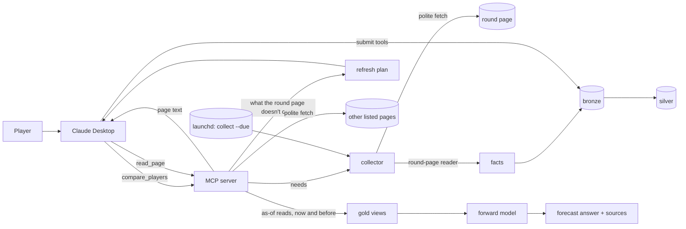

# Design Document: `mvp-collect` (Phase 2, first slice)

Status: **Approved by the owner, 2026-10-30**, with both open points accepted; **amended 2026-10-31** for the
amended requirements (C1, C3, C6, C7, C11, the properties, tests and cost; open points 3 and 4), **the
amendment approved by the owner the same day**, with open points 3 and 4 accepted; C9, C11 and C13 then
count an unchanged page's read as fresh (R1.5), approved 2026-10-31 · From the approved [requirements](requirements.md) and
[ADR-0006](../../../docs/adr/0006-mvp-fantadamus-collects-round-facts.md) · 2026-10-30

## Overview

A player asks "X or Y?". `compare_players` checks what it needs. If anything is missing or stale, it asks the
**collector**, which fetches Fantacalcio-Online's round page (politely), reads it into facts and stores them
through the same bronze → silver flow as a submission. That one page carries every fact that moves until
kickoff: the fixtures, four outlets' lineups, the official lineups and the odds.

What the round page doesn't carry (the table, the penalty takers, players' season figures), or what the
collector couldn't get, goes to Claude through the refresh plan, as before. But Claude no longer browses: it
calls `read_page`, which fetches the listed page under the same rules and returns its text, and Claude submits
the facts. Then `compare_players` answers as a forecast: each probability, why, how sure, how it moved, how
fresh, and the sources.

Principles: the smallest thing that meets each requirement; the Python standard library only (no new
dependency, so ADR-0001 stands). Code reads only the page whose numbers must be exact and refreshed on a
schedule, as a pure function from page text to facts, tested on a synthetic page shaped like the real one.
Every other page is read by Claude from text Fantadamus fetched, so a source is added or changed in
configuration and a redesign doesn't break collection.

## What it builds on

- **`mvp-x-or-y`:**
  - the contracts and quality rules;
  - `domains/facts.py` (submit, rebuild, as-of helpers) and the silver tables;
  - availability consensus, the odds fit and the forward model;
  - `compare_players`, the decision log and the advisor server.
- **ADR-0004's fetching rules and ADR-0006**, which brings them forward.

## Components

### C1. Fetcher (`web/fetch.py`)

One `Fetcher` per collection run, and one for the server's lifetime behind `read_page` (C3.2), built on
`http.client` with redirects followed only within these rules. It gives `fetch(url) -> Page`, where `Page`
carries the URL, the HTTP status, `fetched_at` (from the injected clock), the text and its `content_sha256`.

- **Allowlist:** `host_allowed` from `core/urls.py`; any other host is refused before a request is made (R2.3).
- **robots.txt:** `urllib.robotparser`. Each host's file is cached under `data/local/collect/robots/` with its
  date and re-read at most once a day (R2.1). A disallowed path is never requested.
- **Rate:** at most one request per second per host, measured on an injected monotonic clock with an injected
  sleep, so tests run instantly (R2.2).
- **User agent:** `Fantadamus/<version> (+https://github.com/cpav/fantadamus)`.
- **Blocks:** a 401, 403, 407, 429, 451 or 503, or a page that reads as a bot check (a short list of markers:
  "captcha", "Just a moment", "Access denied"), raises `HostBlockedError`. The run stops using that host and
  reports it; no retry, no workaround (R2.3).
- **Timeout:** 15 seconds per request. One attempt; a failure is reported, not retried.
- **Budget** (task 6.1): a fetcher may get a time budget; each request then waits at most what's left, and none
  starts once it's gone. The collector's fetcher has 60 seconds, so `compare_players` answers within R1.3's
  limit. A robots.txt read cut short is not cached as "fetch nothing today".
- **Blocks that expire** (task 6.3): the fetcher behind `read_page` lives as long as the server, so a host that
  blocks it is left alone for an hour rather than until Claude restarts the server.

### C2. HTML tree (`web/html.py`)

A small element tree built with `html.parser` (standard library): `find_all(tag, class_=...)`, `find(...)`,
`text()` and `attr(name)`. It's enough for the round-page reader to work on the page's structure (class names,
captions, title attributes) rather than on raw text, and for page text to walk any page. About 80 lines.

### C3. Reading pages

Two ways, by what the facts need (R3, amended 2026-10-31). Clubs go through `config/clubs.toml` and players
through name resolution either way (R3.5).

#### C3.1 The round-page reader (`web/readers/fco.py`)

`read_round(page, round) -> RoundFacts` is a pure function from Fantacalcio-Online's round page
(`/it/serie-a/{season}/probabili-formazioni/{n}-giornata`) to its facts: the fixtures, each match's odds, one
outlet lineup per outlet per match, and the official lineups once confirmed. When the structure it relies on
is missing it raises `UnreadablePageError` with the reason, and nothing from that page is stored (R3.4).

The page has one `div.tab-pane` per match, holding a `header.prb-incontro` (the `.prb-partita` elements are
the match tabs at the top; corrected 2026-10-31 from the real page). In each:

- **The match:** the home and away names (`.prb-incontro__nome`) and the kickoff (`.prb-incontro__data`,
  "31/10/2026 15:00" in Italian time), read into `FixturesPayload`.
- **The odds:** three `.stp-qbox` blocks give the 1X2 decimal odds. `.prb-sintesi__mercati` gives "Gol attesi
  3 o più 53%". `.prb-sintesi__ora` gives "quote aggiornate il 30 ottobre alle 18:13", which becomes the facts'
  `published_at`. Together they make a `MatchOddsPayload` with `over_2_5_percent` (C4), bookmaker
  "Fantacalcio-Online".
- **Each team** is a `section.prb-squadra--home` or `--away`, headed by `h2.prb-squadra__nome`, with two tables
  (captions "Probabili titolari" and "Probabile panchina"). The header cells `th.prb-tabella__fonte` name the
  outlets in their `title`: Fantacalcio.it, Gazzetta, SOS Fanta, Sky, and "Tutte le fonti", which is the
  page's own average and is skipped (R4.2). Each row gives the player's role (`span.role`), name
  (`.prb-nome`, with the initial in `<small>`) and one percentage per outlet. This becomes one
  `OutletLineupPayload` per outlet per match.
- **Official lineups:** once the official-lineup column (`.prb-tabella__conferma`) is filled for a team's 11
  starters, the reader also returns an `OfficialLineupPayload`.
- **Unavailable players:** each team's "Indisponibili" list (`div.prb-fuori`, `ul.prb-fuori__elenco`) goes into
  the payloads' `unavailable` (C4).

The reader fails if a block lacks the teams, the kickoff or both teams' tables, if the outlet columns aren't
the four expected, or if a percentage or an odd doesn't parse.

#### C3.2 Page text for Claude (`web/text.py`, the `read_page` tool)

Every other page is read by the user's Claude from text Fantadamus fetched. A new source is a line of
configuration, and a redesign breaks nothing: Claude reads the new layout as it read the old. Claude's
browsing failed in testing (stale caches, refused links, blocked steps); its reading didn't.

- **Addresses (R3.3).** Each fact in `config/reading_list.toml` lists its `pages`, best first, which the
  refresh plan shows with their placeholders filled for the match, club or player. It may also list
  `patterns`: addresses reached only through a link or a search, never shown in a plan, e.g.
  `https://www.fantacalcio.it/serie-a/squadre/{club}/{player}/{id}` for a profile. In both, each placeholder
  matches one path segment. `read_page` accepts an address only if a page or a pattern matches it; anything
  else is refused before any request. The search hints stay: Claude's web search finds an address on a
  listed site, which it then reads through `read_page`. (Pages and patterns split, 2026-10-31, in task 3:
  a profile's address can't be filled in for a plan.)
- **Fetching (R3.2).** The server's long-lived `Fetcher` (C1), so the rate limit holds across calls, with
  robots.txt from the same daily cache.
- **Page text.** `page_text(tree, follow) -> str` walks the HTML tree (C2):
  - it reads `main` when the page has one, otherwise `body`, and skips `nav`, `footer`, `aside`, `form`, `svg`
    and `iframe`;
  - headings become `#` lines, paragraphs and list items lines of their own, and tables rows of cells joined by
    ` | `, header row first;
  - a link with text shows its address, as `text (address)`, only when that address is on the reading list
    (`follow`), so a squad page shows its profile links and none of the menus;
  - whitespace collapses, and a long text is split between lines into parts of at most 40,000 characters
    (about 10,000 tokens each). (Parts instead of a cut, 2026-10-31, in task 3: Fantacalcio.it's probable
    lineups run to 88,000 characters, and a cut would lose half the matches.)
- **The result:** `{url, fetched_at, facts: [{fact, submit_tool}], part, parts, text}`, where the facts are
  those whose pages the address matches, and `part` of `parts` is the text returned; a note at its end says how
  to ask for the next part. Claude submits with `source_url` set to `url` and `captured_at` to `fetched_at`.
  Nothing is stored (R2.4): the text exists only in the tool result.
- **Failures:** off the reading list, disallowed, blocked or failed, as a tool error with the reason; Claude
  moves to the next listed page (R8.1).

### C4. Contracts (`contracts/xy/`)

- **`OutletLineupPayload` 1.0.0 (new).** One outlet's view of one match:
  - `outlet`, `home`, `away`;
  - per team, `players` (each a `name`, an optional Classic `role` and a `percent` from 0 to 100) and
    `unavailable` (names).
  - Quality rules: at least 11 players per team, no name twice, percentages from 0 to 100.
- **`MatchOddsPayload` 1.2.0.** Adds an optional `over_2_5_percent`: the page's own chance of 3 or more goals.
  It's used when a page gives that instead of over/under odds; when both are given, the odds win. This widens
  the contract, so it's a minor version.

### C5. Silver and availability

- **New domain `OUTLET_VIEWS`:** bronze source `outlet_lineup`, silver `outlet_views`: match, outlet, club,
  name, role, percent, and an `unavailable` flag. It comes with a submit tool, `submit_outlet_lineup`, so
  Claude can fall back with the same shape (R8.1).
- **Availability gold** reads outlets from both `lineup_views` (statuses) and `outlet_views` (percentages):
  - for each outlet, the most recent read wins, whichever page it came from (R4.2);
  - a percentage gives p_start directly (R4.1), and a status keeps `mvp-x-or-y`'s mapping;
  - a player missing from an outlet's view still counts 0.05;
  - a name in any fresh `unavailable` list gives p_cameo 0;
  - an official lineup overrides everything (R4.3).

### C6. Collector (`web/collector.py`)

`Collector(fetcher, lake, clubs, pages, clock, log)`. Its entry point is `collect(request, budget) ->
CollectReport`, where a request is "what's due", "this round" or a set of needs from `compare_players`
(fixtures, a match's lineups, official lineup or odds).

1. **Plan the page.** Fixtures, a match's lineups, official lineups and odds all need the round page: the
   reading list's current-round address, or `…/{n}-giornata` for round n. It's fetched once per run, however
   many needs share it, with a new fetcher each run, so a host that blocks is stopped for that run only. The
   current-round address names its round only in the page title ("… - 11ª Giornata"), so the reader takes
   the round from there. The other needs (a profile, the table, the takers) aren't the collector's: they go
   to the refresh plan (C11).
2. **Fetch and read** it with the round-page reader (C3.1), within the budget (60 seconds when
   `compare_players` asks; built in task 6.1, where it's set and can be tested).
3. **Store** each page's facts with `facts.submit_many(domain, payloads, ...)`: one bronze record per payload
   and one silver rebuild per domain per run. `captured_at` is the fetch time, `published_at` the page's own
   time where it shows one, and `submitted_by` is `collector`. Unchanged content stores nothing new (R1.4).
4. **Report** per page: fetched, read, rows stored, or the reason it failed (blocked, disallowed, unreadable,
   timed out). Each run is appended to the collection log (C9).

Page addresses come from a `pages` table (in `config/reading_list.toml`, next to Claude's fallback pages), so
tests point them at a local server and a site's move is a one-line change. The owner can switch a source off
there (R2.5).

### C7. Cadence (`web/cadence.py`)

`due(fact, last_captured, now, kickoff) -> bool` implements R7.1's table. `collect --due` works out what's due
for the next round's matches; it fetches the round page once if anything is. The season facts aren't scheduled
(R7.1): they're read through `read_page` when an answer needs them.

### C8. Storing many facts at once (`domains/facts.py`)

`submit_many` validates every payload first (contract, clubs, host). It appends them to bronze and rebuilds the
domain's silver once. If one payload fails, the others still go in and the failure is reported.

### C9. Collection log (`lake/collect_log.py`)

One JSON line per run in `data/local/collect/<YYYY-MM>.jsonl`, under the git-ignored folder:

- when the run started and finished;
- the request;
- each page: its URL, outcome and rows stored.

`fantadamus collect --report` prints the last run, and the last time each source worked (R8.2). That time also
counts as the refresh of the page's facts when the read found them unchanged (C11; R1.5).

### C10. The `collect` tool and command

- **MCP tool `collect`:** `due` (the default), `round`, or named facts. It returns the `CollectReport`.
- **CLI:** `fantadamus collect [--due | --round N] [--report] [--user NAME]` (R1.2).

### C11. `compare_players` with the collector

`Advisor` gains an optional `collector`.

1. It works out the needs as today.
2. If there are any, it asks the collector for them, with a 60-second budget.
3. It reads the facts again and works out what's still missing. A round-page fact counts as fresh from its
   newest capture or from the collector's newest successful read of its page, whichever is later: a read that
   found the page unchanged stored nothing new (R1.4), but it confirmed the facts (R1.5). The read times come
   from the collection log (C9).
4. Whatever remains goes into the refresh plan. Each item names `read_page`, the pages to pass it, best first,
   and the search hints for finding an address on a listed site; it also says what the collector tried, and
   why it failed (R1.3, R8.1). A fact with no listed page (official-lineup articles and betting previews,
   found only by search) keeps `mvp-x-or-y`'s fallback, Claude's own search and fetch (open point 3).

A sync tool blocking for a few seconds is fine for one player on stdio.

### C12. Many sources, compared (R5)

- **Fixtures and the table** have one true value. Gold now picks the newest fresh value from the
  highest-ranked source (Fantacalcio.it, then Fantacalcio-Online, then Wikipedia) instead of the newest
  overall. A `disagreements(...)` view lists where sources differ for the clubs in the answer, e.g. "kickoff:
  Fantacalcio.it 20:45, Fantacalcio-Online 20:30", and the answer carries them as notes (R5.1).
- **Odds:** the mean of each page's latest de-margined odds, as today (R5.2).
- **Confidence:** every published probability gets a `Confidence`:
  - `sources`: how many outlets or pages gave it;
  - `spread`;
  - `label`: "agree", "disputed" or "one source" (R5.3), or "official" once the official lineup has settled
    p_start (added in task 5: "agree" or "one source" would undersell a confirmed lineup).

  p_start's comes from the outlets, team xG's and the win chance's from the odds pages, and P(scores) takes
  the weaker of the two (disputed, then one source, then agree, then official). Odds pages count as disputed
  when their de-margined 1X2 are 0.10 or more apart, a *(start)* constant; team form alone is one source. In
  `domains/sources.py`; the answer carries `p_start_confidence`, `win_confidence` and `p_scores_confidence`
  per player, and each disagreement as a note.

### C13. The forecast answer (R6)

- **Movement.** For each player, `compare_players` computes the same answer as of an earlier time, without
  collecting or logging. That time is the user's previous answer that included him (from the decision log), or
  24 hours before. It returns before and now for p_start, P(scores) and the win chance, with the facts that
  changed:
  - an outlet's percentage, e.g. "Gazzetta 55% → 90%";
  - an official lineup appearing;
  - the odds changing team xG.

  As-of reads make this exact and cheap (R6.1).
- **Last update:** the newest and oldest times the facts used were captured or confirmed unchanged by a
  collector read (R6.2).
- **Sources:** per player, each page's address with a short label ("Fantacalcio-Online, round 10 probable
  lineups") from a pattern table, for the Sources list (R6.3).
- **The agent prompt.** "How to answer" keeps the owner's shape and adds the forecast parts:
  - the probability first;
  - the reason in one line;
  - the confidence;
  - "up from 60% yesterday: Gazzetta now has him starting";
  - "updated 12 minutes ago";
  - Sources at the bottom (R6.4).

### C14. Schedule on the Mac (R7.2)

`docs/player-setup.md` gains a step with a launchd agent (`~/Library/LaunchAgents/…fantadamus.collect.plist`,
`StartInterval` 900) that runs `uv --directory … run --frozen --no-dev fantadamus collect --due --user NAME`.
The player installs it with one `launchctl` command. Nothing is installed for them.

## Error handling

| Condition | Behaviour |
|---|---|
| Host not on the allowlist | Refused before any request; reported |
| Path disallowed by robots.txt | Not requested; reported; its facts go to the refresh plan |
| Block, bot check or 429 | Stop using that host this run; reported; its facts go to the refresh plan |
| Timeout or network error | Reported; its facts go to the refresh plan |
| Unexpected round-page layout | `UnreadablePageError`: nothing stored from that page; reported loudly; its facts go to the refresh plan |
| `read_page` given an address off the reading list | Refused before any request, with the reason |
| `read_page`'s page disallowed, blocked or failing | A tool error with the reason; Claude reads the next listed page |
| A payload fails its contract | That payload rejected and reported; the page's other payloads stored |
| Budget used up | Stop; what's left goes to the refresh plan |
| Sources disagree on fixtures or the table | Fantacalcio.it's value used; the disagreement shown in the answer |

## Correctness properties

Required Hypothesis tests:

| # | Property | Requirements |
|---|---|---|
| P1 | For any sequence of requests, two to the same host are at least one second apart | R2.2 |
| P2 | No URL that robots.txt disallows is ever requested | R2.1 |
| P3 | Collecting the same pages twice stores nothing new | R1.4 |
| P4 | The round-page reader given a page with any required part removed raises `UnreadablePageError`, never returns partial facts | R3.4 |
| P5 | Consensus over percentage views stays in [0, 1], ignores the order of outlets, and never counts the page's average | R4 |
| P6 | With no facts captured between two times, movement is zero and lists no changes | R6.1 |
| P7 | A fact due at one time stays due at every later time until it is collected | R7.1 |
| P8 | `read_page` requests an address only if the reading list names it or one of its patterns matches it | R3.3 |

## Testing strategy

- **The round-page reader:** unit tests on a synthetic page built by `tests/collect_pages.py`. It copies the
  real page's structure (class names, captions, title attributes) with invented clubs and players, because
  real pages can't be committed to a public repository.
- **Page text and `read_page`:** unit tests on small synthetic pages (tables, links, skipped menus, parts),
  and integration tests through the in-process MCP client against the local server (AT-11, P8).
- **Real pages, optionally:** a contract test runs the reader, and `page_text`, on pages saved under
  `data/private/pages/` when they exist, so a layout change shows up locally. It's skipped, with a registered
  reason, when they don't.
- **Fetcher and collector:** integration tests against a local `http.server` on 127.0.0.1 that serves the
  synthetic pages and a robots.txt, with a fake clock and sleep. They never touch the internet (AT-1 to AT-3,
  AT-6, AT-9).
- **`compare_players`:** end-to-end tests through the in-process MCP client with the collector pointed at the
  local server (AT-4, AT-5, AT-7, AT-8).
- **Manual:** AT-10, a real round for the owner and the second player.

## Cost

$0. Pages are fetched from the player's Mac. The collector makes one request per run, scheduled or on demand.
A cold answer also reads about four pages through `read_page` (the table, the takers, two profiles), each at
most about 10,000 tokens of the user's own Claude plan; with the season facts fresh, it reads none.

## Build order (input to tasks.md)

1. **Contracts and silver:**
   - `OutletLineupPayload`, `MatchOddsPayload` 1.2.0;
   - the `outlet_views` domain;
   - availability over percentages;
   - `submit_outlet_lineup`.
2. **Fetching:** the fetcher (allowlist, robots.txt, rate, blocks) and the HTML tree.
3. **Reading pages:** Fantacalcio-Online's round-page reader, page text and `read_page`.
4. **The collector:** `submit_many`, the collection log, the `collect` tool and command.
5. **Many sources:** source ranking, disagreements and confidence.
6. **`compare_players`:**
   - collecting on demand;
   - movement, last update and sources;
   - the forecast prompt.
7. **The schedule:** cadence, `collect --due` and the launchd guide.
8. **The real round** with the owner and the second player, and the slice report.

## Open points for the owner

1. **Wikipedia cross-checks the table only.** Its season page lists dates, not kickoff times, so in this spec
   fixtures are cross-checked between Fantacalcio.it's calendar and Fantacalcio-Online's round page; Wikipedia
   joins for fixtures later if needed. This narrows R3.3.
   **Recommendation:** accept, since two independent pages already check every kickoff.
2. **Fantacalcio-Online's "Indisponibili" list counts as an outlet saying "unavailable".** That gives p_cameo 0
   (R4.3) without inventing a percentage for any outlet. **Recommendation:** accept.

Both accepted by the owner with the design, 2026-10-30.

From the 2026-10-31 amendment:

- **3. `read_page` reads only listed pages and patterns**, not any page on an allowed host. Search-found
  articles (official-lineup articles, betting previews) keep Claude's own search and fetch as the last
  fallback (ADR-0005) until you approve address patterns for them. **Recommendation:** accept. It keeps
  ADR-0006's route to fixed pages, and the round page covers both facts first.
- **4. The season facts aren't scheduled.** The table, the takers and the profiles are read through `read_page`
  when an answer finds them older than their 7-day target, so about once a week. **Recommendation:** accept.
  Everything that moves until kickoff is on the round page, which the schedule keeps fresh; our own model
  could schedule the rest later, under its own ADR.

Both accepted by the owner with the amendment, 2026-10-31.
