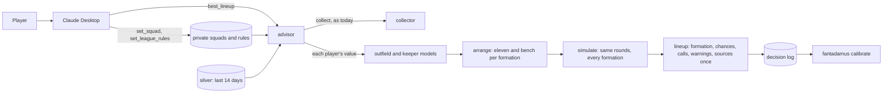

# Design Document: `mvp-lineup` (Phase 2, third slice)

Status: **Approved by the owner, 2026-11-04**, with all three open points accepted · From the approved
[requirements](requirements.md), with the amendments of open point 1

## Overview

A player asks "who do I field?". `best_lineup` reads their squad and their league's rules, gathers every squad player's
facts the way `player_outlook` does, and prices each with the role's model. For each allowed formation it sorts each role
by key to get an eleven and a bench, then simulates the round under the league's real substitution rules. The same
simulated rounds score every formation, so the differences between them aren't noise. The answer is compact, says where
it rests on basic data, and can price the user's own choice against the recommendation.

Principles, as before: the smallest thing that meets each requirement, and no new dependency. A throwaway prototype of the
simulation's loop, with 25 players and seven formations, ran 10,000 rounds in 0.73 s in plain Python on the owner's Mac.

## What it builds on

- **`mvp-roles`:** the outfield and keeper models, `rank.py`, the advisor that takes one name or two, and the statistics
  page, which gives a whole squad at once.
- **`mvp-collect`:** the collector, the refresh plan, confidence, sources and the decision log.

## Components

### C1. What a choice is worth (`engine/rank.py`; R8)

With the bench covering both, fielding `a` before `b` is worth `r_a·k_a + (1 − r_a)·r_b·k_b`, where `r` is the chance of a
rating and `k` the key. The difference between the two orders is exactly `r_a·r_b·(k_a − k_b)`.

- `verdict` keeps ordering by key. `margin` becomes that difference, and `label` comes from it. The difference in keys
  stays as `key_margin`, for the flip search and the breakdown.
- A player with no chance of a rating keeps today's message and the difference in keys (R8.2).
- `docs/method.md` §A3 gets the formula. `mvp-x-or-y` R10.2 gets a note. AT-3 of `mvp-x-or-y` (method §A9 test 6) moves
  from "clear" to "lean", with its order unchanged.

**A forward's cameo (R8.3).** The key needs a chance of a rating and what the rating is worth. `outfield.value` takes his chance
of coming on, and returns the two the method's §A2 means:

| | Before | Now |
|---|---|---|
| `p_cameo` | Chance of coming on | Chance of coming on × chance of a rating once on |
| `e_cameo` | Value of coming on, counting no rating as 0 | What a rating is worth |

Their product doesn't change, so neither does `no_cover`. The key rises for a forward who often comes on, and his chance of a
rating falls to what it really is, which also makes it what calibration should score. The simulation draws from his chance of
coming on, as it already did. A flat cameo always gets a rating, so nothing changes for other roles.

### C2. League rules (`contracts/xy/league.py`, `league/rules.py`; R2)

`LeagueRules` 1.1.0 gains an optional `lineup: LineupRules`, so stored rules stay valid and "X or Y?" keeps working
(R2.2).

| Field | Meaning |
|---|---|
| `format` | `head_to_head` or `total_points` |
| `thresholds` | Rising points for the 1st, 2nd… fantasy goal; past the last, its last step repeats |
| `bench_size`, `substitutions` | Places, and substitutions per round |
| `substitution_mode` | `same_role`; `role_first`, then bench order; or `bench_order` |
| `formations` | Such as `3-4-3`; each must add up to ten outfield players |
| `no_rating_vote` | The vote a player without a rating keeps when nobody replaces him; none by default |
| `other_rules` | Names of rules this spec leaves out, repeated in every lineup's warnings (R2.3) |

A formation change comes with the mode: `same_role` never changes it; the other two may, into an allowed formation only.
`lineup_setup_step` offers the most common values for what's unset, and asks about the no-rating vote and other rules at the
same time without waiting for them (R2.2). `with_stored_lineup` keeps what's stored when a call leaves a setting out. Impossible
values are refused with the reason (R2.4).

### C3. Squads (`league/squads.py`, `mcp/tools/squad.py`; R1)

`set_squad(players, team="mine")`, where each player is a name with an optional club, as in "Rossi (Inter)". Stored per user
and team name in `data/local/league/<user>-squads.json`, git-ignored, by player ID with the name used at the time.

- If nobody is known yet, it first asks the collector for the statistics page.
- Names resolve with `resolve`, among the club's players when one is given. Any name that doesn't resolve stores nothing,
  and comes back with its candidates (R1.2).
- It returns the squad by role, and says if an allowed formation can't be fielded (R1.3).
- A player listed under two names comes back too, so that the squad never holds him twice.

Team names and rosters are personal data about league members, so they never reach the repository, fixtures or logs that
are committed. Tests use invented squads.

### C4. Faster reads (`lake/duckdb_store.py`, `domains/players/resolve.py`, `domains/availability/gold.py`)

Asking about a real 25-player squad took about 5 s under a profiler, nearly all of it matching outlet names to players.

- **Names.** `_words` and `_spellings` are cached, and `availability` resolves each distinct name of a club once per call.
- **Freshness.** The check goes through every row, so `gather` works it out once per kickoff, not once per player. Each match
  keeps its own answer, because lineups go stale sooner close to kickoff.
- **A window on the lake.** `Facts.read(lake, as_of)` reads only rows captured in the 14 days up to `as_of`, filtered in
  DuckDB. No freshness target is longer than 7 days, so no live answer needs more. A replay still works, since the window
  moves with `as_of`. Movement older than 7 days now has no earlier value, which the answer already handles. This also
  removes the 0.8 s a season's statistics rows would have cost.

### C5. The advisor (`mcp/advisor.py`)

`mcp/tools/compare.py` is nearly 1,000 lines, and a third tool would share most of it. So the facts, the models, the advisor
and the shared steps move to `mcp/advisor.py`, and each tool module keeps only its registration and its own result. This
moves code without changing behaviour; the tests change only what they import.

`answer_at` is split so that the lineup can reuse it: `gather(players, as_of)` returns each player's facts and what's
missing. Facts are then sorted into two kinds:

- **Needed:** fixtures, the table, the takers and season figures. Without them the answer is a refresh plan, as today. The
  same goes if no match of the squad has lineups yet.
- **Better to have (R5.5, R5.6):** a match's odds or over/under, and a match whose lineups aren't out. These never hold a
  lineup back: they become warnings, and `improve` items with their pages and search hints.

### C6. Arranging a lineup (`engine/lineup.py`; R3)

`arrange(candidates, formation, rules, start, leave_out)` is pure.

- **Outfield.** Each role is sorted by key. The top fill the formation's places and the rest go to the bench in order (§A3).
  A player with no chance of a rating sorts last, whatever his value.
- **Keepers.** A club's keepers are one place: on a real squad, an unrated backup who rarely starts had a slightly higher
  key than his club's likely starter, from the average prior. The unit's key is the likelier starter's, he is fielded, and
  the other goes first among the bench keepers (R3.3).
- **Bench size.** When the bench has more players than places, the one with the lowest key goes, among those who aren't
  first in their role.
- **Overrides.** `start` and `leave_out` move players before the sort fills the remaining places.

### C7. The simulation (`engine/simulate.py`; R4)

Pure, seeded and standard-library only. Each of `SIMULATIONS = 10_000` rounds is drawn once for the whole squad and scored
for every arrangement, so comparisons between formations share their luck (R4.6).

For each simulated round:

1. **Goals.** Each match in the squad's fixtures draws each side's goals as Poisson from its team xG. This is the only draw
   of a match's goals, which is what links a striker's goal to the keeper who concedes it (R4.3). Each side's chance of
   scoring none stays the clean-sheet chance the keeper model publishes.
2. **Who plays.** Each player starts, comes on or gets no rating, from his chances. Two keepers of one club can't both
   start.
3. **Who scores.** Each goal goes to at most one squad player, by his goal share and minutes, and each assist likewise. A
   first-choice taker adds the model's penalty term.
4. **Scores.**
   - An outfield starter: his vote plus noise, his bonuses, and a yellow card by its chance.
   - His vote lifts by `GOAL_VOTE_LIFT` per goal, lowered in advance so that his expected vote doesn't change.
   - A keeper: his skill less 0.35 per goal actually conceded, plus noise, and the clean sheet or goal-conceded values.
   - A cameo: as the model prices it. It gets a rating or not, and with a rating it blocks his substitute (§A2).
5. **Substitutions.** The league's mode and cap, a keeper only for a keeper, and a formation change only into an allowed
   formation (R4.1).
6. **The result.** The total becomes fantasy goals through the thresholds.

**New starting values** *(start)*, in `constants.py` and calibrated later: `VOTE_NOISE = 0.6`, `KEEPER_VOTE_NOISE = 0.75`
and `GOAL_VOTE_LIFT = 0.85`.

**Measured on 2026-11-04:** 10,000 rounds with 25 players and seven formations took 0.63 s on the owner's Mac, whichever the
substitution mode. A seeded generator needs suppression S-014, because the linter's `S311` rule can't tell a simulation from
a secret.

**A club's keepers in a round.** If their chances add up to more than one place, as 92% and 12% do, they share it in proportion.
If they add up to less, neither may play.

**AT-2 and the method's numbers.** A striker's goal against the user's own keeper is +3, plus the lift to the scorer's vote,
less 1 for the goal conceded, less 0.35 off the keeper's vote. Method §A9 test 5 says about +2.5, and +1.5 if it breaks the
clean sheet. Those hold with a lift of 0.85, which is about what a goal should do to a rating. The method doesn't give the
value, so it's a starting value like the others.

**Results.** For each arrangement: the mean score, the 10th and 90th percentiles (eight rounds out of ten, and the ceiling),
expected fantasy goals, and the chance of each threshold.

### C8. `best_lineup` (`mcp/tools/lineup.py`; R3, R5, R6)

`best_lineup(team="mine", start=[], leave_out=[], formation=None, as_of=None)`, with the statuses `setup`, `squad` (no squad
yet), `choose` (a name to start or leave out could be several players), `refused` (an override that can't be fielded, with the
reason), `refresh` and `lineup`. A replay never collects and isn't logged.

| Part | What it holds |
|---|---|
| `summary` | Round and lock; formation; expected score and range; the chance of each threshold; when it was updated |
| `starters`, `bench` | Per player: name, club, match, chance of starting and its confidence, rivals, value, chance of scoring or clean sheet, penalties. The bench by role and in order, with who's left off |
| `formations` | Each allowed formation: expected score, range, fantasy goals, threshold chances. Enough for format 3 (R6.1) |
| `calls` | The two or three that matter. The formation, from the marginal players of each role (§A7), and the closest choices between a starter and the player behind him, each with what it's worth |
| `out_and_doubtful` | Who, and whether the bench covers him |
| `likely_scorers`, `moved`, `check_before_lock` | Format 2's closing lines. `moved` compares with the previous lineup's log entry for this team, with no replay |
| `warnings`, `improve` | Every number on basic data, and what could improve it (R5.5, R5.6) |
| `override` | With `start`, `leave_out` or `formation`: the cost against the recommendation, from the same simulated rounds (R3.5). Without a formation, the choice goes wherever it does best. Whoever is left out of the eleven stays available for the bench |
| `last_round` | One line on how the last scored round's forecasts did, or nothing yet (R7.6) |
| `sources` | Each page once, by label (R5.4) |

The formation is the one with the most expected fantasy goals, or the highest expected score in a total-points league
(R3.4). Within 0.15 points it's a coin flip, and the answer says which has the higher ceiling.

A player's full breakdown stays with `player_outlook`, which keeps the answer under 15 KB: answers today take about 5 KB per
player, much of it repeated sources, and the target here is about 300 bytes per player.

### C9. The decision log (`lake/decision_log.py`; R7.1)

`Decision` gains `kind="lineup"`, and the optional `team`, `formation`, `expected`, `thresholds` (each threshold's chance)
`starters`, `bench`, `override_cost` and, with an override, `advised_starters`. Every squad player's published chances are logged. Earlier lines still read.

### C10. Calibration (`domains/calibration.py`, `cli/`; R7.2 to R7.6)

Calibration asks a player for nothing, so it fits the routine of a draft, a check before the lock and a look back:

| The player's routine | What they do | What Fantadamus does |
|---|---|---|
| The draft | Ask for the lineup | Logs the chances. Its read of the statistics page separates the last round from this one |
| The check before the lock | Ask again | Logs again. The last chances before each kickoff are the ones scored |
| After the round | Nothing | At the next scheduled run or question, reads the finished round's page and scores the round |
| The next draft | Read one line | The lineup says how the last round's forecasts did |

Chances don't depend on a league's rules, so calibration is the same for every user and adds nothing to the league profile.

**When.** A round is finished 12 hours after its last kickoff *(start)*, so the statistics page has had time to update. Both
`collect --due` and an answer check for a finished, unscored round. An answer scores it after its own read of the pages, which
is what shows the next deadline, so the first question after a round takes a few seconds longer, once. Measured on real data
against the 5-second budget, it takes about 4 seconds: under 1.5 to read the page and under 3 to score everyone. If it ever runs
over, that set moves to `collect --due` and the command. It's skipped in the last hour before a deadline, when speed matters
most. A failed read is tried again at the next run or question, no more often than every 15 minutes, and the answer carries on
without it. Scoring waits for a read of the statistics page after the round, which keeps its usual limit of one a day, until the
next round starts; then what needs that read counts as unscored.

**The finished round's page.** `Collector.collect_finished(N)` reads a past round's page. Its reads are logged as a new page
kind, `finished_round`, so they don't count as an attempt at the current round's page and delay its reads (C7 of
`mvp-collect`).

**What's scored.**

| Chance | Against | Needs |
|---|---|---|
| Starting | The page's marks | The finished round's page |
| Getting a rating | Whether his rated appearances rose | Statistics reads before and after the round |
| Scoring, if he started | Whether his goals rose | The same reads |
| Clean sheet, if he started | Whether a keeper's goals conceded stayed the same | The same reads |

The "before" read is the last before the round's first kickoff, and the "after" read the first once the round has finished,
if it comes before the next round starts. A read that finds the page unchanged stores nothing, so it counts as the last stored
read, if that's from after the first kickoff: the page may have updated inside the 12 hours. One that still shows the figures
from before the round hasn't updated yet, and scoring waits. The player's own draft normally gives both. Otherwise those
chances count as unscored, with the reason (R7.3); so do a postponed match's, which has no marks.

**Two sets (R7.4).**

- **What users were told:** the decision log's last chances for each player before his kickoff. It's the honest record of what
  was published, and small: about 25 players per squad asked about.
- **The model on everyone:** the engine, for every player the page lists, on the facts held before his kickoff, with the
  official lineup left out so that it scores the forecast and not the answer. It doesn't use `gather` (C5), whose freshness
  limits are for answers and would drop facts that were fresh then. It's the current model on the facts held then, so it can
  test a changed constant on past rounds. Starting needs no model: with no lineup held before kickoff, it's the mean of the
  outlets' percentages on the page. A player whose facts weren't held counts as unscored for the other chances.

A logged line has the chance of a rating from the cameo's fix on (R8.3). An older line's `p_cameo` is his chance of coming on,
so that chance counts as unscored for it.

**Output.** Each set's Brier score and reliability by bucket, next to always guessing the set's average, and what's unscored and
why. It's stored as `data/local/calibration/round-<N>.json` and never appended to the decision log, because it's derived and can
be recomputed. `fantadamus calibrate --round N` prints it, with `--again` to recompute it. The aggregates can go in a committed
report; per-player detail stays in `data/local/`.

**Left out of this slice.**

- **The market:** comparing with it, which §A8 also asks for, waits for the market's chances to be logged.
- **Overrides:** the report counts them and the costs stated at the time. Whether they paid off needs each player's score for
  the round, so it comes with the review of a user's lineup (open point 2).

**An assumption to check.** The two rounds read so far suggest a finished page keeps the outlets' last percentages from before
the lineups. Round 11 can prove it, against the same page read before kickoff.

### C11. The league profile (R9.3, R9.4)

Nothing about one user's league is fixed in the code or the prompt. A player sets up their own Claude Project, which has two
parts: the agent prompt, the same for everyone, and their filled-in [league profile](../../../docs/league-profile-template.md).

| What | Where it lives | Who uses it |
|---|---|---|
| Bonuses, thresholds, bench, substitutions, formations | The profile, then the private rules store, through `set_league_rules` | The tools, for the arithmetic |
| Squads, the user's and league-mates' | The profile, then the private squad store, through `set_squad` | The tools |
| Rules Fantadamus doesn't model | The profile, then `other_rules` | The tools, for the warning |
| Preferences: ceiling or floor, formation habits, overrides, routine, language | The profile only | Claude, to explain and prioritise; never the numbers |

So the stores stay the source of truth for the numbers: the tools work the same with or without a profile, and a player can
fill either one by talking to Claude. A test ties the template to `LineupRules` and `LeagueRules`, so a new setting can't be
forgotten (AT-15). Once the server is online (Phase 3), it can offer the blank template itself, since a remote player won't
have this repository.

### C12. The agent prompt and docs (R9.1, R9.2, R6.2)

`set_squad` and `best_lineup`; using the profile when the Project has one (C11); formats 2, 3 and 6; give warnings and try
`improve` once; state an override's cost once, then help with the user's choice. When a user with a squad asks about two roles, point to `best_lineup`. `compare_players`'
two-role message says so too. The README and the player guide say how to give a squad and rules.

## Error handling

| Condition | Behaviour |
|---|---|
| No lineup settings | The setup step for just those settings |
| No squad for the team | Status `squad`: what to ask the user |
| A squad name doesn't resolve | Nothing stored; the names come back with their candidates |
| A stored player is no longer listed | Named in the warnings, and left out of the eleven |
| A role can't fill an allowed formation | That formation is left out, and the lineup says so |
| A forced player isn't in the squad, or the override can't be fielded | Refused, with the reason |
| A match has no odds, or only the 1X2 | Team form or the 1X2, with a warning and an `improve` item |
| A match has no lineups yet | Each player's chance of starting comes from how often he's had a rating (rated games out of his club's), capped at a listed starter's chance, with a warning and an `improve` item. The 5% default for a player no outlet lists would bench a whole match |
| No match of the squad has lineups, or a needed fact is missing | A refresh plan, as today |
| A chance can't be scored | Counted, with the reason |
| A finished round's page can't be read | The answer is unaffected, and it's tried again later |

## Correctness properties

These Hypothesis tests are required:

| # | Property | Requirements |
|---|---|---|
| P1 | For any squad, an arrangement fills the formation exactly with squad players, each role's starters have keys no lower than its bench, and nobody appears twice | R3.2, R3.3 |
| P2 | A club's keepers never start together, and the likelier starter is fielded | R3.3, R4.2 |
| P3 | In any simulated round: substitutions stay within the cap, a starter with a rating is never replaced, a substitute has a rating, a keeper is replaced only by a keeper, and `same_role` never changes the role | R4.1 |
| P4 | Over many rounds, each player's mean score if he starts matches the model's E_start, and a keeper's clean sheets match e^(−xG) | R4.2, R4.3 |
| P5 | Fantasy goals never fall as the score rises, and each threshold's chance is no higher than the one before | R4.4, R4.5 |
| P6 | The same inputs give the same results | R4.6 |
| P7 | A choice's worth never exceeds the difference in keys, doesn't depend on the order asked, and never changes who comes first | R8 |
| P8 | `set_squad` resolves the same players whatever order the names arrive in, and stores nothing if any name fails | R1.2 |
| P9 | Brier scores stay between 0 and 1, and a forecast that was right every time scores 0 | R7.2 |
| P11 | For any forward, the chance of a rating and the key reproduce his simulated mean, starting or coming on, so they can be trusted for ordering | R8.3 |
| P10 | Scoring never uses a chance logged, or a fact captured, after a player's kickoff, and an official lineup never feeds the model on everyone | R7.4 |

## Testing strategy

- **Engine:** unit tests with hand-worked numbers (AT-3, AT-4), and the properties above.
- **Method §A9 test 1 (AT-1):** in the test itself, an exact enumeration of who gets a rating across every ordering of random
  squads, independent of the simulation.
- **Method §A9 test 5 (AT-2):** one match, with a striker and the opposing keeper, with and without the link.
- **Tools:** in-process MCP tests on invented squads, with the collector on the local server.
- **Speed and size (AT-9):** the answer's size in the test suite; the time limit on a synthetic 25-player squad in a process of its
  own, as CPU time, because the coverage tracer slows the simulation about sixfold and other test workers compete for the machine.
- **On real data, from Claude Code, before asking the owner to test:** the local tools with a real squad, kept in private memory
  and never committed. Results stay out of the repository.
- **Manual:** AT-13, in Claude Desktop.

## Cost

$0. No new pages or requests: a lineup reads the same two pages as today, within their limits. The answer takes at most about
5,000 tokens of the user's Claude plan, and a search for better odds uses their plan too.

## Build order (input to tasks.md)

1. **What a choice is worth:** `rank.py`, the method's note, and the tests that move.
2. **Tidy and speed up:** `mcp/advisor.py`, the names cache and the lake's window.
3. **Rules and squads:** `LeagueRules` 1.1.0, the setup step, `set_squad`.
4. **The engine:** `arrange` and `simulate`, with AT-1 to AT-4.
5. **`best_lineup`:** the answer, warnings and `improve`, the log.
6. **Overrides and calls:** `start`, `leave_out`, `formation`, and the cost.
7. **Calibration:** a finished round scored by itself, both sets, and `fantadamus calibrate`.
8. **The agent prompt, the league profile and the docs.**
9. **The real round and Phase 2's gate:** testing from Claude Code, AT-13, the first calibration report, a mutation-testing
   run on the core modules, and the phase report.

## Open points for the owner

1. **The requirements amended from your notes.** Squads can be kept for league-mates. A club's keepers are one place. A close
   call names the higher ceiling. An override's cost is given once. A blank league profile holds what's specific to each
   user (C11). A finished round scores itself, with nothing for you to do (R7, C10). **Recommendation:** accept.
2. **The review after the round.** Your routine ends with one that judges decisions, not results. Calibration scores the forecasts,
   which Phase 2's gate needs, but it isn't a review of your lineup: what you chose, what the advice was, what each decision
   cost at the time, and whether your overrides paid off. The same statistics reads should give each player's rating, goals
   and assists, so it needs no new source. **Recommendation:** leave it out of this slice, and do it right after Phase 2's
   gate, once the logged lineups exist to review.
3. **Modifiers, now that other leagues matter.** Your league has none, so this slice leaves them out. But the defence modifier
   is the most used one, so many other leagues' scores would come with a warning. **Recommendation:** keep it out of this slice
   to close Phase 2 sooner, and build the defence modifier as soon as a real user's league needs it, starting with your
   friend's if it does.

All three accepted by the owner with the design, 2026-11-04.
