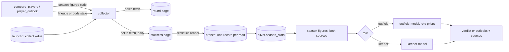

# Design Document: `mvp-roles` (Phase 2, second slice)

Status: **Approved by the owner, 2026-11-03**, with both open points accepted · From the approved
[requirements](requirements.md), with the three corrections of open point 1 · Built before `mvp-collect`'s sign-off, at the
owner's request (2026-11-03)

## Overview

A player asks "X or Y?" about two keepers, two defenders or two midfielders, or asks about one player. The
tools check what they need, as today. If a player's season figures are missing or older than 48 hours, the
collector now reads a second page, Fantacalcio.it's statistics page, which holds every player's season in one
table. One read gives every player's figures to every question until the next round's ratings come in. The
round page still gives the lineups and the odds, for every role.

The engine prices every outfield player with the forward model and his own role's priors, and each keeper
with the method's keeper model (§A6). `compare_players` gives a verdict for two players of the same role, or two
outlooks when their roles differ. The new `player_outlook` gives one player's forecast.



Principles, as in `mvp-collect`:

- the smallest thing that meets each requirement;
- the standard library only, so no new dependency;
- readers are pure functions from page text to facts, tested on synthetic pages shaped like the real ones.

## What it builds on

- **`mvp-x-or-y`:** the contracts, quality rules, silver tables, as-of reads and decision log; the forward
  model and `compare_players`.
- **`mvp-collect`:** the fetcher, the HTML tree, the collector, `submit_many`, the collection log, the cadence and
  `read_page`; the forecast answer (movement, updates, sources, confidence).
- **The round-page reader already reads every role**, and the odds fit already gives both sides' expected goals.

## Components

### C1. Contracts (`contracts/xy/season.py`)

- **`PlayerSeasonPayload` 1.1.0** gains `goals_conceded: int | None` (R6.1), so Claude's fallback submissions
  carry a keeper's goals conceded. The `appearances` description adds "on the statistics page, which has no
  presenze, the same as rated appearances" (R1.3). The rules of R6.2 join its validator: a player who isn't a
  keeper can't have conceded, and a keeper can't have conceded more than 10 a rated appearance. The schema file
  is regenerated, with a changelog entry.
- **`SeasonStatsPayload` 1.0.0** (new) is one read of the statistics page: `players`, a list of rows with the
  same fields and checks as `PlayerSeasonPayload`, written once and shared by both, each player ID once. One
  read is one bronze record. A record per player would put about 600 files in bronze at every read, and over
  45,000 by the end of the season.

### C2. The `season_stats` domain (`domains/season/`)

- **Silver.** `silver.season_stats`, with the same row as `silver.player_seasons` plus `goals_conceded`; the
  player-season row gains the column too (null where unknown). Silver is rebuilt from bronze, so the new column
  needs no migration.
- **Whole-read check (R1.6).** `to_rows` refuses a read that misses a club in `config/clubs.toml`, or has a
  club without a keeper, or names a club the file doesn't know. That's how a layout change or last season's
  page shows up.
- **Gold.** `player_form` and `known_players` read both tables as one: the row captured last wins, whichever
  page it came from (both are Fantacalcio.it). Every player on the statistics page is then known to name
  resolution, so a name that matches several players returns the candidates, as today.
- **Size.** The table grows by about 600 rows at each changed read, roughly 46,000 rows by May. Reading it adds
  0.8 s to each read of the lake's facts by May (measured 2026-11-03: 0.44 s loading the file, 0.29 s
  checking the rows). `compare_players` reads them up to three times a call today, so C9 reads them once, and
  again only after the collector stored something.

### C3. The statistics reader (`web/readers/fcit_stats.py`)

`read_stats(text) -> StatsFacts` is a pure function on the HTML tree (`mvp-collect` C2), shaped like the
round-page reader. It returns the payload and the problems.

| Field | Where on the page |
|---|---|
| Player ID, club | The profile link in `th.player-name`: `/serie-a/squadre/{club}/{player}/{id}`. Each key in `clubs.toml` is the club's slug in these links |
| Name | The link's text, as the page writes it (for example `Milinkovic-Savic V.`) |
| Classic role | `th.player-role-classic span.role[data-value]`: `p d c a` → `P D C A` |
| First Mantra role | The first `span.role-mantra[data-value]`: `por dc dd ds b e m c t w a pc` → `Por Dc Dd Ds B E M C T W A Pc` |
| Rated appearances, average rating | The cells keyed `pg` and `mv`. The page writes `0,0` without a rating, which is read as no average |
| Goals, goals conceded, assists, yellow cards | The cells keyed `gol`, `gs`, `ass` and `amm` |
| Penalties scored and taken | The cell keyed `rig`, `scored / taken` |

- **Not read (R1.2):** the fantamedia (`mfv`), penalties saved (`rp`) and red cards (`esp`): the method uses
  none of them.
- **Appearances** are set to the rated appearances (R1.3).
- **A row that fails its checks** is left out and named in the problems; the rest are kept (R1.6).
- **The page is unreadable** (`UnreadablePageError`) when its title isn't the statistics page's, it has no
  player rows, or a required column key is missing. Nothing is stored from it then.

### C4. The collector reads two pages (`web/collector.py`)

- **Config.** The reading list's `[collector]` table gains `statistics` (the address) and `statistics_enabled`.
  `enabled` keeps switching off the round page alone.
- **Runs.** `collect(round=None, facts=None)` reads the pages whose facts are asked for: the round page for
  `ROUND_FACTS`, the statistics page for `player_season`. With no facts given, it reads both. Each page gets its
  own `PageReport`, with the same fetcher for the run.
- **Storing.** A read that matches the last stored one stores nothing, and its table is listed as confirmed
  (`mvp-collect` R1.4, R1.5). A changed read stores one record.
- **Failure.** When the statistics page fails, or its read is refused, its report lists `player_season` for
  Claude (R1.6).
- **`collect` and `fantadamus collect`.** Both gain the choice of fact (`player_season`, or a round fact) and
  read both pages by default. `--round N` reads only round n's page.

### C5. Cadence and freshness (`web/cadence.py`, `engine/constants.py`)

- **Cadence.** `player_season` joins `SCHEDULED`, due 24 hours after the statistics page's last attempt,
  whatever the matches (R1.4). `CollectLog.last_attempt` takes the page's address, so each page counts from its
  own last attempt. `collect_due` reads only the pages whose facts are due.
- **Freshness.** `FRESH_FOR_HOURS["player_season"]` becomes 48. A daily read that finds the page unchanged keeps
  the figures fresh, through the collection log's confirmed reads, as the round page's facts do.

### C6. The outfield model (`engine/outfield.py`, from `engine/forwards.py`)

- **`OutfieldInputs`** is `ForwardInputs` plus the Classic role.
- **`priors(role, mantra_role)`** returns the goal and assist share priors, the minutes share, the prior weight
  and whether the cameo is priced, from one table in `constants.py`: R2.1's table, with R2.2's fallbacks and
  R2.3's weights (25 for defenders, 15 otherwise).
- **`value()`** is the forward model with those priors:
  - the penalty term uses his own minutes share (R2.4);
  - a priced cameo is the forward cameo (minutes share 0.28), and any other cameo is a flat 5.5 *(start)*.
- **The forward constants** (`GOAL_SHARE_PRIOR`, `ASSIST_SHARE_PRIOR`, `MINUTES_START`) become rows of the table,
  with the same values. The goal bonus comes from the player's Classic role, through `scoring_for` (R2.5).
- **What carries R2.6:** the forward tests pass unchanged apart from their imports, and a test fixes a `T`'s
  move to 0.15 and 0.80.

### C7. The keeper model (`engine/keepers.py`)

`KeeperInputs` holds:

- his rated appearances, average rating and goals conceded;
- the league's goals per team per match, from the table: goals scored over matches played;
- the opponent's expected goals;
- his p_start.

`value()` returns a `KeeperValue` with every step (R3.1 to R3.5):

```text
skill          = average + 0.35 × conceded / rated            (none without a rating)
prior          = 6.0 + 0.35 × league goals per team per match
shrunk skill   = prior + n / (n + 9) × (skill − prior)        n = rated appearances
expected vote  = shrunk skill − 0.35 × opponent xG
P(clean sheet) = e^(−opponent xG)
E_start        = expected vote + clean sheet × P(clean sheet) + goal conceded × opponent xG
p_cameo = 0, so key = E_start and, without bench cover, p_start × E_start
```

- **The clean-sheet chance is exact.** The Dixon-Coles correction moves the low-score cells by amounts that
  cancel in each side's chance of scoring none, so that chance is the plain Poisson value (checked numerically,
  2026-11-03). It is the same fit that gives
  his team's chance to win, or the regressed team form when there are no odds (R3.2).
- **New constants:** `KEEPER_BETA = 0.35` and `KEEPER_SKILL_WEIGHT = 9` *(start)*.
- **Scoring:** the model's `Scoring` gains `clean_sheet` and `goal_conceded`, filled by `scoring_for`.

### C8. Ranking (`engine/rank.py`)

What both models share moves here from `forwards.py`, unchanged:

- `Option`, the key, the expected points without bench cover, the label and `verdict()`;
- the flip search, generalised: given a value function and a bound, it finds where the leader's key meets the
  trailer's.
  - Outfield players use their p_start (down to 0.01) and team xG (down to 0), as today.
  - Keepers use the opponent's expected goals, up to the top of `XG_RANGE` (R4.1). A keeper's p_start can't flip
    the order: with no cameo, his key doesn't depend on it, so only not playing would.

`compare(a, b, scoring)` takes two inputs of the same kind.

**Two keepers of the same club (R3.6).** One plays exactly when the other doesn't, so fielding either gives the
same expected score, and fielding the likelier starter saves a substitution. The verdict puts the higher
p_start first, with the label `covered`, no margin and no flip point: they share one match, so no opponent
changes it.

### C9. `compare_players` for every role (`mcp/tools/compare.py`)

- **The `Advisor`'s reads take one name or two**, so `compare_players` and `player_outlook` share every step:
  the setup step, resolution, freshness, collecting and the refresh plan. The lake's facts are read once a call,
  and again only after the collector stored something (C2's measurement).
- **Collecting.** A stale or missing `player_season` now calls the collector too, for the statistics page, in the
  same 60-second budget (R1.4). Only what it couldn't get goes to Claude. The plan lists the statistics page
  first, then the profile searches.
- **Two players of the same Classic role** get a verdict from the matching model (R4.1).
- **Two players of different roles** get the status `outlooks`: both players and no verdict, with the message
  that a choice between roles is the formation call, which comes with the full lineup (R4.2).
- **The status `forwards only` goes.**
- **`PlayerAnswer.value`** is an `OutfieldValue` or a `KeeperValue`, told apart by a `kind` field. A keeper's
  answer carries his goals conceded, P(clean sheet) and expected goals conceded (R3.5).
- **Movement** adds P(clean sheet) beside P(scores), and the opponent's xG among the changes.
- **The "won't play" advice names the role**: keeper, defender, midfielder or forward (R4.3).
- **Outlet names by surname (R4.4).** When no row of a lineup names him, `availability` counts a row if he is the
  one club-mate with its surname (`same_surname`). Rows that name him strictly
  always win, and his answer's notes say when it was used. Only among club-mates, and only for outlets' rows:
  a user's "Rossi P." stays strict.

### C10. `player_outlook` (`mcp/tools/outlook.py`)

`player_outlook(player, as_of=None)` returns the same statuses as `compare_players` (setup, choose, refresh),
or `outlook`. An outlook holds:

- the round, its deadline and the as-of time;
- the rules used and when the facts were updated;
- what to check before the deadline;
- one `PlayerAnswer` with its movement since the user's previous answer that included him, or 24 hours earlier
  (R5.1, R5.2).

Its tool description names answer format 4.

### C11. The decision log (`lake/decision_log.py`)

- A `Decision` gains `kind`: `compare`, `outlooks` or `outlook`. Its verdict fields (first, second, margin,
  label) become optional, since an outlook has none.
- A `LoggedPlayer` gains `p_clean_sheet` and `expected_conceded`. Its `p_scores` becomes optional: keepers have
  none.
- Every outlook and every two-role answer is logged (R5.3, R6.3).
- Earlier lines still read, through the defaults. The log is still append-only.

### C12. Agent prompt and docs (R7)

- **`docs/agent-prompt.md`:**
  - "X or Y?" is supported for two players of the same role, and `player_outlook` for any player; only the full
    lineup and the formation aren't supported yet.
  - Two roles are answered with two outlooks.
  - Render formats 1 and 4, with a keeper's clean-sheet chance and expected goals conceded in place of the
    chance to score, and rated games in his form.
  - The MVP section says the tools also read Fantacalcio.it's statistics page themselves.
- **`docs/answer-formats.md`:** a keeper's line for formats 1 and 4.
- **`config/reading_list.toml`:** the statistics page first among `player_season`'s pages.
- **`docs/source-registry.md`:** the page added to the Fantacalcio.it row, with its robots check of 2026-11-03.
- **README:** the tool list.

## Error handling

| Condition | Behaviour |
|---|---|
| Statistics page disallowed, blocked, failing or past the budget | Reported; nothing stored; the players' season figures go to the refresh plan, statistics page first |
| Statistics page with an unexpected layout | `UnreadablePageError`: nothing stored; reported; as above |
| A read missing a club, with a club without a keeper, or naming an unknown club | The read refused with the reason ("rejected"); as above |
| One row fails its checks | That row left out and named in the report; the rest stored |
| Two players of different roles | `outlooks`: two outlooks, no verdict |
| Two keepers of the same club | The likelier starter first, label `covered` |
| A keeper without a rating | His skill is the prior; the answer says he has no rated games |
| A keeper's goals conceded unknown (a profile that doesn't give them) | An average defence is assumed; the answer says so |
| An outlet writes a player's name differently | Matched by surname if he's the one club-mate with it, and the answer says so; otherwise he counts as not mentioned |
| No odds for the match | Regressed team form, flagged, as today |

## Correctness properties

These Hypothesis tests are required:

| # | Property | Requirements |
|---|---|---|
| P1 | Given the same statistics page, the reader returns the same rows whatever order they appear in. With a required column or the player rows removed, it raises `UnreadablePageError`. A row with a bad value is left out with a reason, never read as a wrong number | R1.2, R1.6 |
| P2 | Reading the same statistics page twice stores nothing new, and the second read confirms the figures | R1.5 |
| P3 | Two keepers with equal average + 0.35 × conceded per game and equal rated appearances get the same expected vote in any match | R3.3 |
| P4 | P(clean sheet) is in (0, 1] and falls as the opponent's xG rises; so does a keeper's E_start, for any league with clean sheet ≥ 0 and goal conceded ≤ 0 | R3.1, R3.2 |
| P5 | For every Mantra role, with no goals and no games, the goal and assist shares are the role's priors; each share rises with his goals or assists | R2.1 to R2.3 |
| P6 | Raising the league's goal bonus for his Classic role never lowers an outfield player's E_start | R2.1, R2.5 |
| P7 | The verdict for any two players of the same role doesn't depend on the order they're asked in | R4.1 |

## Testing strategy

- **The statistics reader:** unit tests on a synthetic page built by `tests/collect_pages.py`. It copies the real
  page's structure (class names, column keys, data attributes) with the test clubs and invented players,
  because the real page can't be committed.
- **Real pages, optionally:** a contract test reads the saved `data/private/pages/fcit-statistiche.html` when it
  exists (603 rows, 20 clubs, none left out). It also checks that every outlet name on the saved round page
  resolves to one player of its club. That is where a spelling mismatch between the two sites would show. It's
  skipped, with the registered reason, when the pages are absent.
- **Collector and cadence:** integration tests against the local `http.server` serving both synthetic pages
  (AT-6). Unit tests cover the daily cadence and the per-page last attempt.
- **Engine:** unit tests with the numbers of AT-1 to AT-5, and the properties above. The forward tests stay as
  they are.
- **Tools:** in-process MCP tests with the collector pointed at the local server (AT-7 to AT-9).
- **Manual:** AT-10, in Claude Desktop, on a real round.

## Cost

$0. The statistics page is about 1.8 MB, fetched from each player's Mac once a day, and before an answer when
the figures are over 48 hours old. That's two requests a day to Fantacalcio.it for the two players. When the
collector can't read it, Claude reads it through `read_page`: two parts of about 40,000 characters, roughly
10,000 tokens each, on the user's own Claude plan.

## Build order (input to tasks.md)

1. **Contracts and storage:**
   - `PlayerSeasonPayload` 1.1.0 and `SeasonStatsPayload` 1.0.0;
   - the `season_stats` domain and its whole-read check;
   - gold reading both tables.
2. **The statistics reader:** the reader, the synthetic page, the reading list and the source registry.
3. **The collector reads two pages:**
   - the config;
   - per-page last attempts;
   - the daily cadence and the 48-hour freshness target;
   - `collect` and `fantadamus collect`.
4. **The engine:** `rank.py`, the outfield priors by role, the keeper model (AT-1 to AT-5).
5. **`compare_players` for every role:**
   - same-role verdicts;
   - two-role outlooks;
   - same-club keepers;
   - the decision log.
6. **`player_outlook`.**
7. **The agent prompt, answer formats and README.**
8. **The real round** (AT-10) and the slice report.

## Open points for the owner

1. **Three corrections to the approved requirements**, made in this pull request, in the change order:
   - **R1.1:** "as a `player_season` fact" becomes "one record per read". The figures are the same; only the
     storage changes, for the 45,000-file reason in C1.
   - **R7.2:** the data-product catalog is dropped. No slice has created one (`docs/data-products/` doesn't
     exist), and starting it for one product isn't worth it now.
   - **AT-1, method §A9 test 3:** as written, it can't hold with the method's own weight. Regressing five
     matches with n / (n + 12) keeps 5/17 of a raw gap. Clubs that conceded 6 and 9 in five matches give one
     keeper about +0.95 on raw form, and about +0.28 after regression, not 0.1. The two keepers come within 0.1
     only once the lines price their matches alike, and the method calls the lines the best prior (§A5).
     AT-1 becomes: about +0.9 raw, about 0.3 regressed, within 0.1 on matching odds.

   **Recommendation:** accept all three. The alternative for AT-1 is regressing team form much harder, which
   would change a method constant to fit a test.

2. **The statistics page's figures win when they're newest**, over a profile Claude submitted earlier: both are
   Fantacalcio.it's own figures, and the daily read keeps them current. **Recommendation:** accept.

Both accepted by the owner with the design, 2026-11-03.
