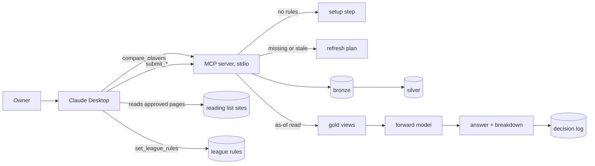

# Design Document: `mvp-x-or-y` (Phase 1)

Status: **Approved by the owner, 2026-10-26**; amended for R10.7 and R13.4 the same day · From the approved [requirements](requirements.md) · 2026-10-26

## Overview

The owner asks "X or Y?" in Claude Desktop. Claude calls `compare_players`. If a fact is missing or stale,
the tool returns a refresh plan; Claude reads the listed pages and submits what they say; Claude asks again
and relays the answer. All arithmetic happens in tested Python ([method](../../../docs/method.md) §A2 to §A4).

Design principles, from the re-plan: the smallest thing that meets each requirement; no new dependencies;
everything the method calls *(start)* in one constants module, so calibration later changes one file.

## What it builds on

- **Spec 0:** the contract base and bronze envelope, `LakeStore` (Parquet through DuckDB), the URL allowlist
  (`config/sources.toml`), the MCP server and CLI, the agent hooks and `make check`.
- **ADR-0005** (collector mode) and ADR-0001 (tools). No new ADR and no new library: the odds fit is plain
  Python.

## Components

### C1. Clubs (`config/clubs.toml`)

The 20 Serie A clubs of 2026/27, each with a canonical key and the spellings outlets use ("Inter",
"Internazionale", "FC Internazionale Milano"). Every submit tool maps club names through it and rejects an
unknown club with the list of known ones. It's configuration, so a promoted club next season is a one-line
change.

### C2. Contracts (`contracts/xy/`)

One versioned contract per submit tool, each with its quality rule (R8) as a model validator, so a bad
submission is rejected with a field-level reason and nothing is written.

| Contract | Fields | Rule |
|---|---|---|
| `FixturesPayload` | round; matches: home, away, `kickoff_at` | Known clubs; each club once per round |
| `ProbableLineupPayload` | outlet; match; per team: starters, ballottaggi (players with shares), bench, unavailable (all by name) | 11 starters per team (R8.1); shares sum to 95–105 % (R8.2) |
| `OfficialLineupPayload` | match; per team: starters, bench | 11 starters per team |
| `MatchOddsPayload` | match; bookmaker; 1X2; over/under 2.5; optional goal/no goal (decimal odds) | Each market's margin within 0–15 % (R8.3) |
| `PlayerSeasonPayload` | player ID, name, club, Classic role, optional Mantra role, appearances, rated appearances, average rating, goals, assists, yellow cards, penalties scored and taken | Plausible figures (R8.4) |
| `TeamSeasonPayload` | per club: played, goals for, goals against | Known clubs |
| `PenaltyTakersPayload` | per club: takers by name, in order | Known clubs |
| `LeagueRules` | the R12.1 table, signed values; goal as one value or per role | Bonuses 0 to 10, maluses −10 to 0 (R12.2) |

Every submission also carries the Spec 0 envelope: the page's URL (checked against the allowlist), its
publication time if shown, `captured_at` and the pseudonymous user ID. A `captured_at` later than the time
the server receives it is stored as that time: a page can't be read after it arrives, and a collector's clock
running a few minutes ahead would otherwise hide its facts from a question asked now.

### C3. Domains (`domains/{fixtures,availability,odds,season}/`)

One shared flow (`domains/facts.py`) wraps a submission in its envelope, appends it to bronze and rebuilds
the domain's silver table from all its bronze records; each domain's `silver.py` says how a payload becomes
rows, and its `gold.py` holds the as-of reads. **Silver keeps history:**
every row carries `captured_at`, the outlet and the bronze hash, and nothing is overwritten (R7.2). There
are no materialised gold tables: gold is computed on read for an as-of time (C6), which is what makes replay
possible (R7.4) and keeps one fewer copy of the data.

| Silver table | From | Key columns |
|---|---|---|
| `fixtures` | `submit_fixtures` | round, home, away, kickoff |
| `lineup_views` | probable lineups | match, outlet, club, name as written, status, ballottaggio share |
| `official_lineups` | official lineups | match, player, starter or bench |
| `odds` | match odds | match, page, de-margined 1X2, P(over 2.5), P(both score) |
| `player_seasons` | profiles (R6.1) | player ID, name, club, roles and the R6.1 figures; a player's identity is his latest row |
| `team_seasons` | league table | club, played, goals for and against |
| `penalty_takers` | takers page | club, order, player |

### C4. Name resolution (`domains/players/resolve.py`)

Names are normalised (case, accents, spaces, as Spec 0's identity check does). A name resolves to a player
when it equals his full name, or his surname and that surname is unique among known players; an outlet's
"Lautaro M." style matches surname plus initial. Lineup names stay in silver as the outlet wrote them and
are resolved on read against the club's players with profiles, so a name becomes a player as soon as his
profile arrives. `compare_players` returns candidates rather than guessing (R1.3).

### C5. Availability (`domains/availability/consensus.py`)

- Per outlet *(start)*: starter 0.90; in a ballottaggio, his share; on the bench 0.05; unavailable 0; **not
  mentioned at all 0.05** (an outlet lists every squad player it expects to be involved, so silence means
  bench at best).
- p_start: the mean over the fresh outlets for that match, with each outlet's value and the spread; disputed
  when the spread is 0.30 or more and at least two outlets were read (R3.3).
- p_cameo = 0.5 × (1 − p_start), or 0 if any fresh outlet lists him unavailable (R3.4).
- An official lineup replaces all of that (R4.2).
- **One fresh outlet is enough to answer;** the refresh plan asks for three, and the answer says how many it
  used.

### C6. Gold views (`domains/*/gold.py`)

Pure functions over silver rows, all taking `as_of` and ignoring rows captured after it (R7.4):
`availability(player, match, as_of)`, `team_xg(match, as_of)`, `player_form(player, as_of)`,
`penalty_order(club, as_of)`, `fixture(club, round)`. Each returns its value with the sources it used
(URL, outlet, `captured_at`, hash), which flow into the answer and the decision log.

### C7. Odds fit (`engine/odds.py`)

1. De-margin each market by proportional normalisation; average the fresh pages.
2. Model: independent Poisson goals for each team with the Dixon–Coles adjustment on 0–0, 1–0, 0–1 and 1–1,
   ρ = −0.10 *(start)*, scores up to 10.
3. Fit (λ_home, λ_away) by least squares against P(home), P(draw), P(away), P(over 2.5) and, when present,
   P(both score): a grid over 0.20–4.00 in steps of 0.2, then a pattern search around the best point that
   halves its step down to 0.0005. The correction only touches the four low scores, so it has closed forms
   and one evaluation is cheap. Deterministic, a few milliseconds, no library.
4. Outputs: team xG for both teams, P(win), P(draw), P(loss).
5. Without odds: regressed team form (R5.3), the club's goals for and against per match shrunk toward the
   league average with weight n / (n + 12).

### C8. Forward model (`engine/forwards.py`, `engine/constants.py`)

Pure functions, one per method formula, each taking its inputs explicitly (R9):

| Function | Formula (R9) |
|---|---|
| `expected_vote(n, average, p_win, p_loss)` | 6.0 + n/(n+10) × (average − 6.0) + 0.3 × (p_win − p_loss) |
| `share(prior, events, team_goals)` | (prior × 15 + events) / (15 + team_goals) |
| `expected_goals(xg, share, minutes, penalty_taker)` | xg × share × minutes + (0.15 × 0.78 × minutes if first taker) |
| `p_yellow(cards, appearances)` | (0.15 × 10 + cards) / (10 + appearances) |
| `e_start(...)` | vote + goal × E[goals] + assist × E[assists] + yellow × P(yellow) |
| `e_cameo(...)` | P(cameo goal) × 9.8 + (1 − P) × 0.6 × 5.75, with minutes 0.28 |
| `key(p_start, e_start, p_cameo, e_cameo)` | method §A3 |
| `compare(a, b, rules)` | verdict, margin and label, flip points, the verdict without bench cover, and whether each player can get a rating at all (R10.7) |

`constants.py` holds every *(start)* value with the method section it comes from. The flip point is found by
solving the key for the leader's p_start and team xG with the other inputs fixed (bisection, both bounded
to [0, 1] and [0, 5]).

### C9. League rules (`league/rules.py`)

Stored as one JSON file per user under the git-ignored `data/local/league/`, validated by `LeagueRules` on
read and write; each save keeps the previous file as `<user>.<timestamp>.json`, so a change can be traced.
Penalty scored is applied as a goal for the taker term. The setup step (R12.3) lists every field with its
Classic starting value and one line on what it means.

### C10. `compare_players` (`mcp/tools/compare.py`)

1. No league rules for the user → the setup step.
2. Resolve both names (C4) → candidates, or a refresh plan for a missing profile, or "forwards only" (R1.4).
3. Find the round: the first one whose deadline (first kickoff) is after `as_of`; each player's fixture.
4. Collect needs and freshness (R7.3): fixtures, lineups for both matches, odds for both matches, both
   profiles, the league table, the penalty takers.
5. Anything missing or stale → the refresh plan (C11).
6. Otherwise: gold views → forward model → the answer (R10) → append to the decision log (C12) → return. A
   player with no chance of a rating is never put first on the bench (R10.7).

`as_of` defaults to now from the injected clock and may be passed explicitly, so an old question can be
replayed. Answers are structured (a pydantic result model); the agent prompt tells Claude how to word them.

### C11. Refresh plan (`config/reading_list.toml`)

The reading list as data: for each fact, the pages (fixed URLs or URL templates) and search hints, best first,
and the submit tool. Every fact has at least two of them, including a search hint, and Wikipedia is never
first (R11.4): Claude works down the list until one opens. `compare_players` fills the templates with the
clubs and players involved and orders the items lineups → odds → season figures (R11.2). The file is checked
in a test against `config/sources.toml`, so every page it names is on the allowlist.

### C12. Decision log (`data/local/decisions/<YYYY-MM>.jsonl`)

One JSON line per answer (R14.1), written with append mode only; nothing in the code opens it for writing
otherwise. The month split keeps files small. Git-ignored, like the lake.

### C13. Server and Claude Desktop

- `fantadamus serve` exposes `compare_players`, `set_league_rules` and the seven submit tools. The skeleton's
  two tools stay for `fantadamus skeleton run` but are **no longer served** to Claude, so its tool list only
  shows what the owner uses.
- The server's instructions are `docs/agent-prompt.md` (R13.2), read at start-up.
- `--user` sets the pseudonymous user ID (default `owner`); the league rules and every submission carry it.
- The README gains the `claude_desktop_config.json` entry, using uv's full path, since Claude Desktop doesn't
  read the shell's PATH.

## Error handling

| Condition | Behaviour |
|---|---|
| Host not on the allowlist | Rejected with the host; nothing written |
| Contract or quality rule fails | Rejected with the field and the rule; nothing written |
| Unknown club | Rejected with the list of known clubs |
| Lineup name not resolved | Stored by name; resolved when a profile arrives; a player in `compare_players` without a profile → refresh plan for his profile |
| No league rules | The setup step |
| A player isn't a forward | Says this slice compares forwards only |
| Odds missing after a refresh attempt | Answer from regressed form, flagged |
| As-of before any data | Refresh plan |

## Correctness properties

Required Hypothesis tests:

| # | Property | Requirements |
|---|---|---|
| P1 | p_start and p_cameo are in [0, 1] and their sum is at most 1, for any outlet views | R3 |
| P2 | An official lineup always wins over any probable lineups | R4.2 |
| P3 | Consensus doesn't depend on the order the outlets were submitted | R3.3 |
| P4 | An as-of read never sees a fact captured after its time | R7.4 |
| P5 | Name resolution doesn't depend on the order players were learned | R1.2 |
| P6 | Fitted team xG reproduces the de-margined 1X2 and over/under within 0.01 for any consistent market | R5.2 |
| P7 | Raising a player's E_start, all else equal, never lowers his rank | R9.8 |
| P8 | The decision log only grows; earlier lines are unchanged | R14.2 |

## Testing strategy

- **Unit:** every formula in C7 and C8 against hand-computed values, including method §A9 tests 2, 4 and 6
  (AT-1 to AT-3, fixed inputs below); name resolution; the setup step; the plan's ordering.
- **Contract:** each payload contract against synthetic submissions shaped like each page, including the R8
  rejections (AT-7).
- **Integration:** in-process MCP client, scripted Claude: empty lake → refresh plan → scripted submissions →
  answer → log entry (AT-4, AT-5, AT-6, AT-8, AT-9, AT-10).
- **Fixtures:** synthetic only (public repository): invented players at invented clubs, with odds and lineups
  chosen to hit known answers.
- **Manual:** AT-11, the owner's real round in Claude Desktop.

Fixed inputs for the method's tests:

- **AT-2:** centre-forward (`Pc`), 4 goals in 5 appearances, club scoring 2.0 per match, team xG 1.35, 88 %
  to start → goal share 0.34, P(scores if he starts) ≈ 0.32. Rotation striker (`W`), 1 goal in 8
  appearances, club 1.2 per match, team xG 1.1, 25 % to start → P(scores if he starts) ≈ 0.12. The
  centre-forward ranks ahead.
- **AT-3:** X: p_start 0.45, p_cameo 0.10, E_start 7.6, E_cameo 6.0 → key 7.31; Y: 0.95, 0.02, 6.6, 6.0 →
  key 6.59. Answer: start X, Y first on the bench. Without bench cover: X 4.02, Y 6.39, so Y.

## Cost

$0: everything runs on the owner's Mac. Collection uses the owner's Claude plan.

## Build order (input to tasks.md)

1. Clubs, contracts and the reading list, with their tests.
2. Fixtures and profiles (players, seasons, team table, penalty takers), with name resolution.
3. Lineups: probable and official, availability consensus.
4. Odds and the team xG fit.
5. The forward model, with method §A9 tests 2, 4 and 6.
6. League rules and the setup step.
7. `compare_players`: refresh plan, answer, decision log; the server and Claude Desktop setup.
8. The owner's real round (AT-11) and the slice report.

## Open points for the owner

None. The calls made here (an unmentioned player counts 0.05, one fresh outlet is enough, the skeleton
tools are hidden from Claude, ρ = −0.10) are all starting values or reversible.
